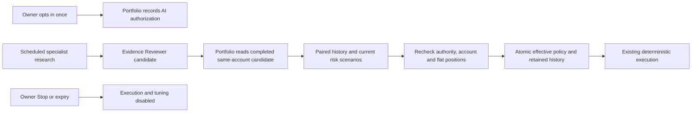

# AI-managed strategy

## Owner controls

For `adaptive-intraday-v2`, the owner can select **Let AI manage strategy** when
reviewing and enabling Auto trading. The choice starts unchecked. The exact account,
initial rules, authorization and expiry are recorded together. Existing mandates
are never converted automatically. Development and tests use fake brokers.

AI may change exposure, concentration, stop-risk and daily-loss fractions up to
100%, plus the listed technical settings. Verified cash, fees, reserved orders and
the existing execution checks still determine what can actually be spent. These
limits and historical scenarios do not guarantee a maximum loss or future profit.

## Flow and ownership

| Boundary            | Behavior                                                                                                                                                                                                                                                                                             |
| ------------------- | ---------------------------------------------------------------------------------------------------------------------------------------------------------------------------------------------------------------------------------------------------------------------------------------------------- |
| Team                | Produces a typed candidate only while the supplied AI authorization is enabled; exact reviewer assessment evidence binds the run, account and baseline.                                                                                                                                              |
| Candidate transport | Portfolio performs a bounded read of Team's completed reviewer candidate. No owner token or broker credentials go to Team or model workers.                                                                                                                                                          |
| Technical values    | Position count, spread, slippage, profit/stop/trailing distances, volume ratio, exit/cooldown/order lifetime and ATR multiplier use existing validation.                                                                                                                                             |
| Fixed scope         | Version, exchange universe, excluded assets, future-deposit behavior, fees, freshness rules and owner expiry cannot change through a candidate.                                                                                                                                                      |
| Evaluation          | Baseline and candidate use the same seven-day native 5/15/60-minute history for up to three observed markets. Record dataset fingerprints, metrics and current-account risk scenarios.                                                                                                               |
| Evidence limits     | Unknown fills or incomplete history defer changes. Each chronological segment needs a sufficiently sampled comparable strategy. Cost-aware results must not worsen; drawdown must fit the proposed daily-loss scenario. This is hypothetical evidence, not verified account profit.                  |
| Portfolio risk      | Both policies use the existing risk engine against the same verified capital and current quotes. These are individual current-market scenarios, not a simulation of correlated portfolio losses. Live sizing still checks cash, reservations, exposure, concentration and stop risk for every order. |
| Application         | No active paper/live orders, owned positions or conflicting manual orders. Recheck fresh unchanged capital, account, authority, expiry and baseline under the existing gate and revision-based save. SQL rechecks manual exposure in the transaction.                                                |
| Audit               | Keep the initial mandate hash, effective hash, reviewed candidate, before/after rules and applied evaluation. Applied history is append-only. The last deferred evaluation remains visible to research.                                                                                              |
| Cadence             | Check for work every minute; persist a 15-minute admission interval before network work. Candidates expire within 30 minutes. Duplicates never apply twice.                                                                                                                                          |
| Stop and overrides  | Stop, Emergency stop, mode changes and owner rule edits disarm tuning and execution. Expired authorization cannot apply or execute.                                                                                                                                                                  |

## When AI keeps the current settings

- No fresh reviewed candidate, stopped research or unavailable dependencies.
- Insufficient historical samples, missing intervals or ambiguous simulated fills.
- Existing orders or positions still need their original parameters.
- Account capital, rules or authorization changes during comparison.

These conditions leave the existing authorized policy running; they do not grant
permission to force a trade. Trading status shows the last result and reason. The
effective values remain available in Settings; an owner edit revokes the mandate.

## Storage and verification

Optional fields use existing Portfolio and Team JSON payloads. No new SQL schema or
account migration is required. Original legacy rule hashes and omitted optional
fields remain compatible. Applied policies must retain their lineage when restored;
an old strict decoder cannot read new AI history even after stopping. Use a compatible
corrected build once AI authorization has been recorded; never strip retained history
to make a downgrade appear compatible.

Run `npm run test:ai-policy`, the full Portfolio/Team/API checks and
`npm run test:trading-entry`. The browser fixture intercepts activation requests and
never calls the real broker. Real SQL checks remain opt-in.
