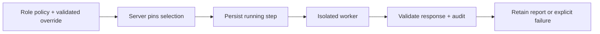

# Research model policy

The worker requests an explicit model and reasoning effort for each role from
[CodexModelPolicy.json](../services/ai-worker/CodexModelPolicy.json). The server
pins that selection before starting the worker and retains it with the report.
Requested model identity is distinct from the actual model, which the installed
SDK does not expose. Research never grants financial authority.

## Workload and requested selection

| Role      | Supplied-data task                                | Requested model | Effort | Rationale to evaluate                                                   |
| --------- | ------------------------------------------------- | --------------- | ------ | ----------------------------------------------------------------------- |
| CEO       | Bounded synthesis/priorities; server owns routing | gpt-6.1-sol     | low    | Avoid expensive planning loops for a short scoped report                |
| Analyst   | Legacy evidence synthesis/calculations            | gpt-6.1-sol     | medium | Multi-source units, costs and uncertainty                               |
| Intraday  | Completed bars/liquidity/alert description        | gpt-6.1-sol     | medium | Check coverage, timestamps and supported calculations                   |
| Swing     | Supplied longer-horizon evidence                  | gpt-6.1-sol     | medium | Preserve thesis/invalidation limits without inventing data              |
| News      | Supplied source/event/revision extraction         | gpt-6-luna      | low    | Focused extraction; retains the same Reviewer/evidence gates            |
| Positions | Actual wallet/fill/exit evidence                  | gpt-6.1-sol     | medium | Missing history and available/reserved funds are material               |
| Quant     | Supplied study/result diagnosis                   | gpt-6.1-sol     | high   | Less frequent statistical/protocol reasoning; cannot run tools          |
| Reviewer  | Specialist claims and pinned assessment schema    | gpt-6.1-sol     | medium | Start within the fixed timeout; high requires explicit profile override |

These are workload hypotheses, not measured quality/latency improvements or a
trading edge. No Astra default or automatic escalation is introduced. Same-family
specialist and Reviewer errors can be correlated; a second report is not
independent verification. Typed lineage, source freshness, arithmetic, coverage,
schema validation and deterministic Portfolio guards remain mandatory.

## Evidence and limits

The installed host catalog (client 0.163.0, observed 2026-10-21) lists these model
IDs and low/medium/high efforts. The deployed worker uses Codex SDK 0.162.1,
whose ThreadOptions accept model and modelReasoningEffort. Catalog listing does
not prove availability for the isolated authenticated worker. An unsupported or
unavailable request fails; there is no application fallback or automatic retry.
The SDK's typed Turn/events expose usage, not a resolved model identity.

Keep account-specific runtime observations and usage records in private
operational evidence. A concentration of failures in Reviewer does not establish
that reasoning effort caused them: inspect schema, lineage, freshness and input
budgets first. Stored token counts are not an invoice or an exact count of
underlying HTTP requests; historical model identity and monetary cost may remain
unknown.

Existing durable per-account caps remain three attempts per rolling hour:
ordinary lane two, positions lane one, including failed claims. Automatic tasks
use specialist + Reviewer (two application turns); legacy manual tasks use
CEO + Analyst + Reviewer (three). Mixed maximum is eight application turns per
account per rolling hour. This is not a global account token or currency cap.
The supervisor still enforces 180 seconds and kills the worker process tree;
no repeated expensive loop is added. Report length validation is not an inference
token limit. Codex subscription quota consumption remains unmeasured.

## Configuration and audit

CodexModelPolicy.json is the common role mapping. A server-only
QUANTARA_CODEX_ROLE_POLICY override may replace exact role model/effort pairs
within the reviewed allowlist. Invalid models, efforts, roles, extra properties
and lowering Positions/Quant/Reviewer to Luna or low are rejected. Changing model
selection does not change trading authorization.

The immutable C# profile is selected before spawn and saved with the Running
step. Only that pinned profile reaches Node; it is not derived from report text,
news, user home settings or a model's self-identification. Stored audit includes
requested model, requested provider, effort, policy version and selection source.
actualModel is null with sdk-not-exposed provenance, fallback is null, and missing
usage stays null. Failure/cancellation retains the server selection. Mismatched
worker audit is rejected and its usage is not attributed to the expected model.
Legacy records retain unknown metadata. Model policy is separate from trading
RulesHash and cannot renew a mandate.

## Validation and evaluation

Offline mocks cover all eight role profiles, supported overrides, rejected
unsupported input before spawn, tool/network restrictions, unknown actual model,
malformed output, usage validation, timeout/quota failure and no fallback/retry.
C# fixtures cover old JSON, profile validation, success/failure audit mismatch,
pre-spawn persistence and preservation of the pinned selection. Compilation
and runtime checks are available through the commands below. These tests use
fake workers and cannot establish actual model reasoning quality.

| Check                | Command                              | What it proves                                                      |
| -------------------- | ------------------------------------ | ------------------------------------------------------------------- |
| Role mapping         | `node tools/verify-model-policy.mjs` | Defaults, overrides, rejected profiles and unknown actual identity  |
| Role instructions    | `node tools/verify-role-prompts.mjs` | Bounded prompts, permitted handoffs and preserved evidence          |
| Worker boundary      | `npm run test:ai-worker`             | Isolation, response handling and failure behavior with mocks        |
| Server orchestration | `npm run test:team`                  | Persisted selection, lineage, account scope and contract validation |

### Report quality criteria

- Tie the conclusion to supplied facts, units and source times.
- Identify material contrary evidence or uncertainty without inventing confidence.
- Name the smallest new fact that would change the conclusion.
- Distinguish a supported descriptive finding from a validated trading edge.
- Reopen a task only when its stated evidence condition changes; do not repeat
  stale blockers or treat historical learning as current proof.

A later quality evaluation should use pinned synthetic cases for stale/missing
wallet data, reserved funds, the unresolved historical residual, inconsistent
units/fees, foreign account/policy evidence, source injection and malformed
assessment fields. Grade unsupported claims, financial meaning, exact lineage,
schema validity, useful bounded findings, latency, usage and reviewer corrections.
Contract mocks do not measure actual model quality. A comparative benchmark needs
sanitized inputs, the intended OpenAI/Codex destination and a fixed call budget
within the owner's authorized scope. Record the tested profile and results; do
not describe a single smoke test as a quality benchmark or proof of profitability.

Official capability context: [Codex SDK](https://developers.openai.com/codex/sdk)
and [model selection](https://developers.openai.com/codex/models). Higher effort
can take longer and use more tokens; validate the tradeoff on this workload.
