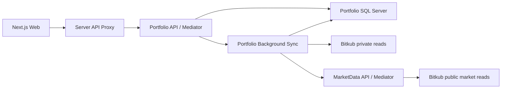

# Architecture

Quantara uses one frontend and small services separated by business ownership
rather than one process per class.

## Boundaries

- Each service owns its Domain/Application/Infrastructure/Api projects. No project references cross service directories.
- Domain has no framework packages. Application references Domain and Mediator abstractions. Infrastructure implements Application interfaces. API composes dependencies and exposes thin controllers.
- Portfolio query handlers receive a read-only repository interface. Commands schedule import; the background job is the only account import writer.
- MarketData owns public coin/price reads and has no database or credentials. Portfolio owns account reads and SQL Server. HTTP contracts are mapped locally, never shared through another service's Domain assembly.
- Each class/record/interface/enum has its own matching file. Controllers, queries, commands, handlers, persistence and adapters are separated. Compiler/analyzers and architecture checks enforce these boundaries.

## Frontend

Routes re-export class screens. UI components extend Component/PureComponent. Each crypto component lives in its own folder with its Props/State files. The CryptoPage screen container owns lifecycle, cancellation, polling and history cache. Components obtain services through Context; they cannot import concrete clients or construct service instances. PortfolioService and HistoryService implement IPortfolioService/IHistoryService and depend on IRequestService through their constructors. The interfaces are compile-time TypeScript contracts, not runtime DI tokens. RequestService owns fetch, HTTP errors, no-store and AbortSignal propagation; feature services validate transport data with Zod. CryptoController methods are exported directly as Next.js route handlers; CryptoProxy forwards to Portfolio. Shared code never imports features or other services. One component or declared type per matching file, with Next.js route filename conventions retained.

The client ServiceProvider in app/providers is the composition root. ServiceBindings registers typed class factory methods in ServiceContainer; registration never creates service instances. Each container lazily resolves and caches a service when first used, detects missing/circular bindings and retries failed factories without caching a failed instance. Portfolio and History resolve the same scoped RequestService dependency. CryptoServices exposes these lazy dependencies as ICryptoServices through CryptoServiceContext; components receive feature interfaces rather than calling a generic registry. CryptoPage reads the typed Context with static contextType. ServiceProvider accepts optional services overrides at mount for isolated implementations/mocks. Dependencies stay stable for that provider's lifetime; remount the provider to replace the binding. No process-wide singleton or external DI package is used. Request cancellation/timers remain owned by the screen rather than shared services. Lazy construction does not imply dynamic module loading; registered implementations remain statically bundled.

No standalone application functions or hooks are allowed; ESLint enforces this in the editor/build. Class methods and inline event/collection callbacks are permitted. RootDocument.render is the server layout adapter (Next.js invokes its exported method); client pages re-export real class components. Third-party React/Next.js/MUI implementations retain their own internals.

RequestService receives the shared base URL through its constructor (default `/api`) and joins relative resource paths with one slash. HistoryService owns `/crypto/history`; PortfolioService owns `/crypto` and appends `/portfolio` or `/sync`. Feature services do not duplicate the server address. Browser traffic still uses the same-origin Next.js proxy; broker/service addresses remain on the server.

Portfolio, history, polling, abort handling, filters, status, error recovery and formatting are separate responsibilities. UI colors, compact rows, focusable table scrolling and English copy retain DESIGN.md behavior.

## Data compatibility

The existing Quantara SQL database remains exclusively owned by Portfolio. `CryptoPortfolioLedger`, account-key SHA-256 partitioning and JSON property names are preserved. The first idempotent SQL migration only creates missing schema; it never deletes existing records. Retained closed coins and deduplicated fills survive the move.

## Execution

MarketData defaults to port 5051, Portfolio to 5050, Team to 5052 and Web to 3000.
Service addresses are configuration, not Domain dependencies. Broker credentials
stay in Portfolio's server environment or the root .env allowlist. Startup does
not authorize transactions. Team produces reports through an isolated Codex SDK
worker. Separately, Portfolio now supports individually human-reviewed THB spot
limit orders. There are no automatic orders, market orders, derivatives,
transfers, withdrawals or RiskEngine.

## Individually reviewed orders

Daily Brief includes a current Order review queue, independent of the selected
report date. The owner manually creates a proposal and sees exact spend (THB
for buys), base quantity (for sells), immutable limit price in THB per coin,
reference price, estimated THB fee, reason and a three-minute approval deadline.
The owner checks the exact-order review checkbox and clicks Approve & submit.
Creating a proposal, polling, waiting and expiration cannot submit an order.
The AI report pipeline does not generate proposals or call these endpoints.

The class component receives OrdersService through its own Context and the lazy
ServiceContainer. Zod validates transport enums, decimal strings and timestamps.
Next.js proxies guarded local-origin requests to thin OrdersController ->
Mediator handlers. Keep this deployment on loopback; it is not a multi-user,
remotely authenticated trading application. Broker credentials remain exclusively
in Portfolio. Additive OrderProposals SQL storage uses the existing account-key
partition without changing the portfolio ledger or its retained history.

Approval reads live Bitkub spot rules, ticker and available balances. Invalid
precision, price steps, minimum value, unavailable markets, insufficient balance,
expiration or a reference-price move greater than 1% prevent submission. The
approved amount and limit price are never adjusted. THB fees are estimated at
0.25%, rounded upward to two decimals, before fee credits; buy fees are deducted
from spend and sell fees from proceeds. Sources:
https://github.com/bitkub/bitkub-official-api-docs/blob/master/rest-v3.md
https://support.bitkub.com/en/solutions/articles?id=151000035191

A serializable SQL claim moves Pending to Submitting before one signed broker
POST, with a stable client_id derived from the proposal ID. Concurrent API hosts
and tabs cannot claim the same proposal, and an in-flight or uncertain account
submission blocks another claim. No HTTP POST retry is configured. A disconnected
browser does not cancel outcome persistence. Success means Submitted, not filled;
approval expiry does not cancel an accepted limit order. Open orders must be
managed in Bitkub in this slice.

Transport ambiguity becomes Unknown; failed outcome storage leaves Submitting.
Neither state is resent on restart or repeated approval. They block further
account submissions until explicitly reconciled; an in-app reconciliation tool
is not implemented here. Check Bitkub and the stored client reference before
operator reconciliation. Deterministic checks cover expiry during preflight,
duplicate approval, late rejection, insufficient funds, price changes, unknown
outcomes, storage failures and exact signed buy/sell bodies. Browser fixtures
cover explicit review, timeout behavior, local-origin guards and three viewport
sizes. These checks never use broker secrets or send real orders.

Team owns its own SQL Server database and retained run/step state. Its thin
controller delegates to Mediator query/command handlers. Read handlers receive
IReadOnlyTeamRunStore. A single hosted coordinator admits one active run and
performs CEO, Analyst and Reviewer sequentially, preserving each output before
the next role. Stop cancels the process tree; terminal and retained output cannot
be overwritten by a late model response. Startup marks interrupted runs failed
without automatically rerunning them. No service assembly crosses ownership.

CodexWorker passes JSON via stdin to services/ai-worker/run.mjs, reads bounded
stdout and discards raw stderr. It clears inherited environment variables and
allows only OS runtime variables plus the Codex auth-home and launcher paths. Portfolio data
comes through HTTP and an explicit field whitelist, never SQL credentials or
Bitkub secrets. The Node worker creates a temporary working directory,
disables shell/exec, plugins, hooks, additional agents, apps and web search,
and runs read-only with no shell network. The SDK uses the Team.Api apphost's
narrow `exec` dispatch to launch the pinned CLI with `--ignore-user-config` and
`--ephemeral`, retaining the existing ChatGPT auth cache for normal refresh without
copying tokens or importing personal config/tools. Reports are validated structured
output and displayed as plain text. OpenAI model access remains required.

Each role has its own `services/ai-worker/roles/<role>/AGENTS.md` and `SKILL.md`.
The worker explicitly loads the selected role's bounded documents into each prompt;
native project/skill discovery stays disabled. Invalid roles cannot select paths,
and missing or empty role instructions fail before a model request. These are
versioned research profiles, not new execution permissions. The owner's profit
objective and willingness to lose allocated capital inform research comparisons;
they do not authorize autonomous real-money orders or losses beyond deposited
capital. Buffett-inspired valuation is distinguished from forced daily trading
and cannot manufacture a valuation for assets with unsupported fundamentals.
Cash, spot and options/futures are research candidates. Historical experiments,
paper orders and derivatives availability must not be claimed without actual
data, an implemented simulator and verified venue/account support. No execution
or derivatives adapter is introduced by loading a profile.

CompanyLoop is a hosted deterministic scheduler. A new owned CompanySchedule table
persists enabled state, next-run reservation and last-run ID without changing
retained runs or Portfolio schema. New companies enable research under the owner's
2026-10-13 direction. The scheduler reserves an hour before admitting a round,
checks dependencies every 30 seconds and never overlaps work or catches up missed
rounds. A due round requests Portfolio's existing read-only sync before taking a
snapshot; failed readiness retries the sync no sooner than five minutes. The CEO
chooses analysis priorities from a fixed research mandate. The persisted objective
references the prior run ID; the coordinator loads its full Reviewer output as
untrusted context, including the task ledger. Roles retain stable task IDs and
distinguish Done, Pending and Blocked from report completion. No schema change is
required; the ledger remains recorded report text, not a separate task engine.
The server collects existing read-only Portfolio history over HTTP for at most
10 coins and 20 recent retained fills each, with explicit truncation and availability.
The snapshot defines THB units, BTC/THB-style pairs, ticker-price semantics and
coin value excluding cash. History remains incomplete and unknown costs remain
unknown. Models use this evidence; they do not call broker endpoints or tools.
This does not
create orders or financial authority. Stop/Resume use thin controller -> Mediator
commands; the overview query receives IReadOnlyCompanyLoop. A saved stop survives
restart; a failed save stops locally and exposes the unconfirmed persistence.

Daily Brief (`/daily-brief`, with `/team` retained as an alias) is a read-only
day view. Its class component resolves TeamService through Context and the lazy
container. GET `/api/team/brief?date=yyyy-MM-dd` delegates through Mediator to
the read-only store and selects existing runs by their creation day in Bangkok
time (UTC+07:00), ordered by creation time and ID. SQL schema and retained history
are unchanged. The supported date range is 1970-01-01 through 9999-12-30.

The conversation displays recorded role outputs as plain text; these are reports,
not an invented chat transcript. Only task creation times are shown because step
timestamps are not stored. The summary area displays recorded Reviewer outputs,
not a newly generated daily synthesis. Members show selected-day task status,
not online presence. Date changes cancel prior reads, historical days never poll,
and today's view polls every five seconds during work or every thirty seconds
while automatic research is enabled. Visiting the page only reads state; the
server-owned loop continues independently of the browser. Company controls affect
the current loop even when a historical conversation is selected.

CI checks are implemented, but remote branch protection is an administrator setting and is not changed by adding a workflow. Account integration and SQL checks are opt-in; default CI uses deterministic fake transports and isolated browser fixtures.

## Blank-line enforcement

C# IDE2000/IDE2003 reject consecutive blank lines and require a blank line between a completed block and the next statement. CSharpier owns whitespace and wrapping, so conflicting IDE0055 formatting diagnostics are disabled; CSharpier checks remain required in CI. These Roslyn blank-line options are experimental, so SDK upgrades must retain the diagnostic probe verification.

QNT005 requires a blank line between C# type members, including fields, constructors, properties and methods. The blank line goes before the next member's documentation or attributes. Comments alone do not substitute for a blank line. This analyzer reports errors in the editor and build.

Frontend ESLint Stylistic requires a blank line after the directive/import group, after block-like statements and before return statements, and allows at most one consecutive blank line. Editor lint and CI enforce these rules; Prettier preserves the required spacing. No rule requires an empty line between every statement.

## Typed domain and presentation

Domain statuses and trade sides use enums. JSON converters live in Infrastructure
and are configured at the API/SQL boundaries; persisted lowercase trade sides,
PascalCase ledger properties and camelCase API properties retain their contracts.
Required trade fields cannot silently become default enum values.

Frontend enums and Zod schemas validate the same wire spellings. Class
components render views through named Props; ConnectionStatusPresenter uses
explicit access modifiers and readonly state to encapsulate state precedence
and appearance. Filtering is a pure operation that returns a new array.
Nested ternaries, explicit any and non-exhaustive enum switches fail ESLint.
