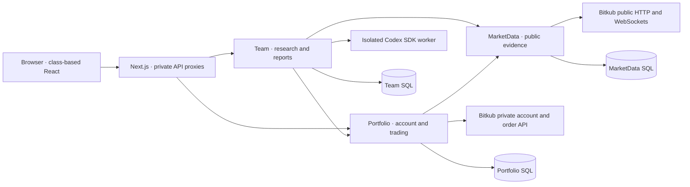

# Architecture

Quantara is a loopback, single-owner trading workspace. Business ownership defines
service boundaries; small classes remain in the service that owns their behavior.
Read [code instructions](../code-instructions.md) for engineering rules and
[trading](trading.md) for execution semantics.

## Service ownership

| Owner      | Responsibilities                                                                                                                       | Persistent state                                                                                   |
| ---------- | -------------------------------------------------------------------------------------------------------------------------------------- | -------------------------------------------------------------------------------------------------- |
| Portfolio  | Account imports, retained holdings/history, cost basis, objectives, risk, manual proposals, deterministic execution, Telegram delivery | Account-partitioned portfolio/trading records, authority, durable claims, fills and delivery state |
| MarketData | Public markets, quotes/depth, native candle evidence, research signals, bounded watch subscriptions and official news feeds            | Candles, news revisions, source health and pilot evidence                                          |
| Team       | Read-only research scheduling, CEO/Analyst/Reviewer handoffs, reports, review memory and model budgets                                 | Account-bound runs/steps, company schedule, budget claims and consumed signal keys                 |
| Web        | English UI, lazy service composition, validated transport and same-origin private proxies                                              | Component state only; no broker credentials or execution authority                                 |

Crypto read models reconcile confirmed engine fills with wallet observations for
scoped cost and P/L. [Accounting and delivery](crypto-accounting.md) documents
unknown semantics, duplicate handling and durable Telegram acknowledgements.

Automatic research selects a focused specialist followed by Evidence Reviewer; the
legacy manual three-role flow remains supported. Team owns durable rolling-hour
admission, role cadence and evidence lineage. [Continuous research](continuous-research.md)
describes the per-role skills, budget fallback and recovery limits.

Each backend has four projects:

| Project        | Role and dependencies                                              |
| -------------- | ------------------------------------------------------------------ |
| Domain         | No HTTP, JSON, database or framework dependencies                  |
| Application    | Uses Domain and Mediator abstractions; queries use read-only ports |
| Infrastructure | Implements Application ports                                       |
| Api            | Composes dependencies and exposes thin Mediator controllers        |

Services communicate through HTTP and never share assemblies or database
ownership. SQL Server may host the three databases in the same container.

## Frontend structure

- **Routes:** Re-export class screens; `/team` remains an alias for `/daily-brief`.
- **Composition:** `app/providers` composes a lazy, provider-scoped
  `ServiceContainer`. Registration does not instantiate services. Resolution caches
  successful factories, detects missing/circular bindings and leaves failed factories
  retryable. Context exposes feature interfaces; components do not construct clients
  or access a generic registry.
- **Feature organization:** Folders separate contracts, API adapters, services,
  presentation and components. Each component lives beside matching Props/State files.
- **Screen ownership:** Containers own polling, aborts, generation guards and actions.
  Focused class components render trading books, market coverage, settings, mandate
  review, news, conversation and summary. Shared presentation classes own formatting
  and repeated status metadata.
- **Trading settings:** Adaptive setup opens with a read-only system-managed plan and
  saved risk limits. Numeric editors stay inside explicit Advanced overrides; material
  saves disarm live trading and require owner review again.
- **Component rules:** Hooks, function components and standalone application functions
  are disallowed; inline callbacks inside class methods remain valid.
- **Transport:** `IRequestService` owns fetch, same-origin `/api` path joining, HTTP
  failures and AbortSignal propagation. Feature services validate external data with
  Zod. Next.js route adapters delegate through server-only proxies; service addresses
  and control tokens never enter browser code.

App labels and compact, accessible layout follow [DESIGN.md](../DESIGN.md).

Home projects recorded Team steps into eight stable office seats through a pure
state adapter. Its lazy renderer imports only the pinned Pixel Agents engine;
it has no upstream transport, terminal, discovery or execution bridge. Home reads
existing Team queries and never starts research or trading. See
[Home office](home-office.md) for state, lifecycle, licensing and fixture checks.

## Trading execution

Portfolio has three separate paths:

| Path         | Behavior and authority                                                                                                                          |
| ------------ | ----------------------------------------------------------------------------------------------------------------------------------------------- |
| Paper        | Simulates observed fills and fees. New state defaults here.                                                                                     |
| ManualReview | Creates an immutable pending spot LIMIT proposal. Only an explicit, verified owner approval may submit that exact proposal before its deadline. |
| AutoLive     | Uses deterministic policy decisions inside an exact owner-enabled account/rules-hash/market-scope/risk/expiry mandate.                          |

- Team and models cannot choose AutoLive orders, enable it or widen authority.
- Stopped stays stopped after restart.

The owner-authenticated `POST /api/trading/prepare` accepts only the exact account key
and current rules hash through Mediator. Preparation checks identity and the retained
and recomputed hash under the existing control gate, then uses the same configuration
guards and revision-based save. Initial legacy setup uses system-owned v2 defaults;
an explicit v1 upgrade preserves every saved technical parameter, risk cap, exclusion
and compatibility field. Existing v2/v3 rules, hashes and authority remain exact.
Preparation never enables AutoLive; actual changes revoke the old mandate.

Execution preserves these boundaries:

- The `TradingEngine` coordinates one serialized decision gate. Separate collaborators
  own signal processing, live execution, read-only reconciliation and Paper fills.
- Pure evaluation, precision and ledger-valuation rules have no transport side effects.
- The state writer retains revision-based compare-and-swap before external actions.
- Prepared broker observations are collected outside the gate, then checked against
  the exact retained order before applying fills.
- Live claims, final authority checks, timeouts and uncertain outcomes preserve their
  original ordering.

MarketData sends authenticated private SSE events to Portfolio:

- A bounded dispatcher prioritizes owned exits and coalesces quotes; overflow retains
  dirty owned symbols.
- Required holdings/open orders stay watched, with rotating candidates inside the
  64-symbol bound. Broader scans run separately.
- Completed native candles permit entry evaluation; fresh owned quotes evaluate exits
  without waiting for a candle.
- Separate maintenance and reconciliation timers survive quiet or disconnected markets.

| Policy                              | Compatibility and evidence                                                                                             |
| ----------------------------------- | ---------------------------------------------------------------------------------------------------------------------- |
| Legacy fixed-symbol and adaptive v1 | Mandates retain their hashes and scope.                                                                                |
| Adaptive v2                         | Selects verified native 5/15/60-minute history and sizes from verified account capital, including future deposits.     |
| Experimental v3                     | Remains gated by frozen shadow, paired historical and portfolio holdout evidence; elapsed time alone never enables it. |

See [adaptive risk](adaptive-risk.md), [exit protocol](adaptive-exit-protocol.md) and
[the evaluation plan](background-jobs-and-adaptive-exit-plan.md).

- Disable, Emergency stop, expiry and material changes disarm live authority. They do
  not prove existing broker orders were cancelled or positions closed.
- Durable claims precede broker POSTs; uncertain submission/cancellation outcomes are
  reconciled read-only and never automatically resubmitted.
- Manual and autonomous paths share account locking.
- Development, CI and maintenance never activate live trading.

## Research and model isolation

- **Scheduling:** The persisted company loop admits non-overlapping hourly rounds and
  deduplicated market/news-triggered research under its cooldown and rolling/day
  budget limits. Stop/Resume survives restart; failures expose state instead of
  inventing a successful report. Startup does not replay interrupted model work or
  financial actions.
- **Evidence collection:** Team reads account evidence over Portfolio HTTP, checks
  account identity around collection and retains each source timestamp. HTTP
  collection is separate from pure Trading/Research snapshot projections and bounded
  JSON parsing. Missing prices, costs, candles, source coverage and profit stay
  Unknown; omitted context is explicit. Native timeframe selection and manual
  five-minute proposal evidence remain distinct.
- **Coordinator:** Preserves each CEO, Analyst and Reviewer step before proceeding.
  Prior reports and learning memory are account-scoped, bounded, untrusted evidence.
  The optional typed assessment binds account/run/policy/evidence/as-of/expiry; its
  position suggestions are read-only and existing v2 never consumes them as orders.

The Node worker has these isolation boundaries:

- Receives allowlisted data over stdin in an isolated temporary workspace.
- Shell, tool access, network tools, plugins, hooks, apps and personal configuration
  are disabled. Only the selected bounded role AGENTS.md/SKILL.md are loaded.
- Codex authentication stays server-side.
- Output schemas are separate from worker lifecycle and validated responses; .NET
  also validates business evidence.
- Errors cross boundaries as fixed allowlisted messages, without raw prompts, tokens
  or SDK error bodies.
- Temporary workspaces and supervised process trees are cleaned up.

## Objectives, notifications and jobs

Portfolio tracks an account-scoped total-wallet-equity objective, including
confirmed deposits. The target amount and Bangkok closing date come from the
configured account evidence:

- It is metadata separate from rules and mandates, not guaranteed profit or a trade quota.
- Reserved cash is counted once; closing observations remain frozen and incomplete
  account P&L stays Unknown.
- Historical studies, reference-price comparisons and opportunity costs are hypothetical
  research, separate from account profit and financial authority.

| Delivery area | Responsibility                                               |
| ------------- | ------------------------------------------------------------ |
| Telegram      | Sends concise Thai confirmed-fill notes and critical alerts. |
| Hangfire      | Dispatches retained report/notification work.                |

- Manual review callbacks require the exact private-chat owner, account, notification
  and message ID.
- Delivery/review claims persist before side effects; mock buttons have no real authority.
- Ambiguous sends and reviewed submissions are not automatically replayed.
- Hangfire does not choose orders or grant approval. Its private dashboard permits GET
  and the exact bounded read-only `POST /stats` protocol. Job commands remain blocked.

See [background jobs](background-jobs-and-adaptive-exit-plan.md) for recovery constraints.

## Operations and verification

Runtime requirements:

- Docker Compose is the canonical local runtime: web, Portfolio, MarketData, Team
  and SQL. Only web is published on loopback.
- Native execution is a development or verified reverse-migration path and must not
  compete with active Docker database ownership.
- Maintenance requires AutoLive disabled, canonical COPY_ONLY/CHECKSUM backups and
  restore verification.
- Additive schema does not imply old strict-JSON binaries can read new documents.

Follow the [Docker](docker-runtime.md) and
[native runtime](local-runtime.md) recovery guides.

| Verification                                       | Scope and limits                                                                                     |
| -------------------------------------------------- | ---------------------------------------------------------------------------------------------------- |
| Compiler/analyzers, CSharpier, ESLint and Prettier | Enforce checked style in editor, build and CI.                                                       |
| Architecture checks                                | Enforce matching type files, class components, layer/service boundaries and a transport-free Domain. |
| Deterministic checks                               | Use fake brokers; browser fixtures intercept mutation APIs.                                          |
| SQL and real-account checks                        | Opt-in.                                                                                              |
| Passing CI                                         | Does not configure remote branch protection or prove profitability.                                  |
