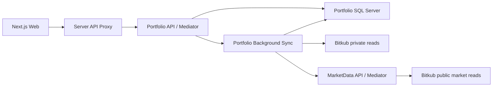

# Architecture

Quantara uses one frontend and small services separated by business ownership
rather than one process per class.

## Boundaries

- Each service owns its Domain/Application/Infrastructure/Api projects. No project references cross service directories.
- Domain has no framework packages. Application references Domain and Mediator abstractions. Infrastructure implements Application interfaces. API composes dependencies and exposes thin controllers.
- Portfolio query handlers receive a read-only repository interface. Commands schedule import; the background job is the only account import writer.
- MarketData owns public coin/price reads and its own intraday candle database, with no broker credentials. Portfolio owns account reads and its SQL Server database. HTTP contracts are mapped locally, never shared through another service's Domain assembly.
- Each class/record/interface/enum has its own matching file. Controllers, queries, commands, handlers, persistence and adapters are separated. Compiler/analyzers and architecture checks enforce these boundaries.

## Frontend

Routes re-export class screens. UI components extend Component/PureComponent. Each crypto component lives in its own folder with its Props/State files. The CryptoPage screen container owns lifecycle, cancellation, polling and history cache. Components obtain services through Context; they cannot import concrete clients or construct service instances. PortfolioService and HistoryService implement IPortfolioService/IHistoryService and depend on IRequestService through their constructors. The interfaces are compile-time TypeScript contracts, not runtime DI tokens. RequestService owns fetch, HTTP errors, no-store and AbortSignal propagation; feature services validate transport data with Zod. CryptoController methods are exported directly as Next.js route handlers; CryptoProxy forwards to Portfolio. Shared code never imports features or other services. One component or declared type per matching file, with Next.js route filename conventions retained.

The client ServiceProvider in app/providers is the composition root. ServiceBindings registers typed class factory methods in ServiceContainer; registration never creates service instances. Each container lazily resolves and caches a service when first used, detects missing/circular bindings and retries failed factories without caching a failed instance. Portfolio and History resolve the same scoped RequestService dependency. CryptoServices exposes these lazy dependencies as ICryptoServices through CryptoServiceContext; components receive feature interfaces rather than calling a generic registry. CryptoPage reads the typed Context with static contextType. ServiceProvider accepts optional services overrides at mount for isolated implementations/mocks. Dependencies stay stable for that provider's lifetime; remount the provider to replace the binding. No process-wide singleton or external DI package is used. Request cancellation/timers remain owned by the screen rather than shared services. Lazy construction does not imply dynamic module loading; registered implementations remain statically bundled.

No standalone application functions or hooks are allowed; ESLint enforces this in the editor/build. Class methods and inline event/collection callbacks are permitted. RootDocument.render is the server layout adapter (Next.js invokes its exported method); client pages re-export real class components. Third-party React/Next.js/MUI implementations retain their own internals.

RequestService receives the shared base URL through its constructor (default `/api`) and joins relative resource paths with one slash. HistoryService owns `/crypto/history`; PortfolioService owns `/crypto` and appends `/portfolio` or `/sync`. Feature services do not duplicate the server address. Browser traffic still uses the same-origin Next.js proxy; broker/service addresses remain on the server.

Portfolio, history, polling, abort handling, filters, status, error recovery and formatting are separate responsibilities. UI colors, compact rows, focusable table scrolling and English copy retain DESIGN.md behavior.

## Data compatibility

The existing Quantara SQL database remains exclusively owned by Portfolio. `CryptoPortfolioLedger`, account-key SHA-256 partitioning and JSON property names are preserved. The first idempotent SQL migration only creates missing schema; it never deletes existing records. Retained closed coins and deduplicated fills survive the move.

## Execution

The canonical local deployment runs the web, Team, Portfolio, MarketData and
SQL services in Docker Compose. Only the web service is published to the host;
the API services and SQL remain on private Compose networks. Native scheduled
tasks are a retained development and verified reverse-migration path, and must not be started
against the active Docker databases. See [Docker runtime](docker-runtime.md)
and [local runtime](local-runtime.md) for lifecycle and migration rules.

MarketData defaults to port 5051, Portfolio to 5050, Team to 5052 and Web to 3000.
Service addresses are configuration, not Domain dependencies. Broker credentials
stay in Portfolio's server environment or the root .env allowlist. Startup does
not authorize transactions. Team produces reports through an isolated Codex SDK
worker. Portfolio supports individually human-reviewed THB spot limit proposals
and a separate deterministic trading worker governed by an owner-enabled
AutoLive mandate. New trading state defaults to Paper. There are no market
orders, derivatives, transfers or withdrawals. See [trading](trading.md).

## Deterministic trading authority

The 2026-10-16 owner direction in `newfeature.md` authorizes one live activation
for an exact account, versioned strategy/policy hash, eligible THB universe,
capital/risk caps and expiry. Adaptive mode uses actual account capital,
includes future deposits and supports up to 16 positions; legacy fixed-symbol
JSON remains compatible and is never silently widened. Within that unchanged,
unexpired mandate, the Portfolio-owned worker
evaluates completed five-minute candles and manages spot LIMIT entry/exit orders
without individual approval. It does not call the legacy approval command.
AI/Team remain research only and never grant or choose this order authority.
ManualReview remains a separate individually approved path. Material rule or
account changes, expiry, Disable and Emergency stop disarm AutoLive; timers and
restart recovery cannot create a new mandate.

Portfolio owns additive account-partitioned trading state, versioned rules,
mandates, decisions, durable order intents, fills, positions, risk counters,
alerts and report delivery. Its existing SQL database and retained ledger remain
intact. Durable execution claims precede broker side effects; uncertain
submissions stay blocked until exact reconciliation, without resending. Public
market evidence arrives from MarketData over HTTP. Paper uses simulated funds
and fills; live accounting uses actual fills and known cost basis, preserving
Unknown profit/equity when evidence is incomplete.

The class-based Daily Brief trading panel uses validated feature contracts,
Context and lazy service bindings. It displays the server's mode, heartbeat,
exposure, orders and selected-day Thai report. The owner uses **Set up and
review** for the adaptive preset, then reviews account, scope, caps and expiry
before one Enable action. Staged setup values are never presented as active
account data.
Next.js guards local-origin JSON controls, bounds request bodies, validates
actions and adds `X-Quantara-Trading-Control` only on the server. Portfolio
checks its owner token separately. Docker preparation generates and preserves
the token in private `runtime.env`; only Portfolio and the web server receive
it. Server setup, page mounting, polling, research and tests never enable live
trading. The application remains a loopback, single-owner deployment.

At 23:59 Asia/Bangkok, verified accounting produces a concise Thai daily report.
Delivery claims and corrections are retained. Missing fills or cost basis do
not become zero profit. Critical alerts cover risk/stop, stale data, uncertain
execution, reconciliation mismatch and prolonged outages. The worker runs
independently of the browser but still requires the PC, network, Docker and
services to remain available.

## Individually reviewed orders

Telegram is an additional human review channel on Portfolio. A private-chat
button is accepted only for the configured owner, account-scoped notification
nonce and exact Telegram message ID. Real cards explicitly say REAL ORDER;
mock callback data never matches the real protocol. The adapter dispatches the
same Mediator approval/rejection handlers as the web screen, exclusively after
a verified individual human click. No scheduled job or AI decision supplies
that approval. Both channels use the proposal's existing three-minute deadline.

Portfolio owns additive OrderNotifications and TelegramCursors tables. Delivery
is reserved before sending, and review is claimed/audited before dispatch. A
delivery timeout or crash before recording its message ID is not automatically
resent; use the web screen. A crash after recording a review never replays its
submission: the web screen and existing broker reconciliation remain the
recovery path. Display retries cannot re-submit. Bot credentials stay in the
Portfolio environment allowlist; API request exceptions/HTTP logs never expose
their token-bearing paths. The server must remain running and online; Telegram
long polling does not expose the web API publicly. No webhook is installed.

Team obtains account-scoped fresh wallet evidence through Portfolio's read-only
GET /api/crypto/account/evidence. Collection rejects observations older than
60 seconds or more than five seconds ahead; after sequential AI reports the
proposal window is ten minutes, with another fresh broker balance read at final
approval. Buy and sell budgets use Available, never reserved/total balances.
Imported positions, cost basis and valuations keep their original timestamps.
Zero balances are explicitly omitted from model context to preserve its size
budget. The published THB 0.25% baseline is sourced and dated; future fill fees,
credits, execution and tax remain estimates or unknown, not realized profit.
Disabling Telegram leaves web review and all existing history intact. Rolling
back binaries retains the additive tables; no ownership/schema wipe is needed.

Daily Brief includes compact current trade proposal messages, independent of
the selected report date. Each message shows exact spend (THB for buys), base
quantity (for sells), immutable limit price in THB per coin, estimated THB fee,
reason and a three-minute approval deadline. The owner clicks Approve or Reject;
the Approve click explicitly confirms and submits that exact proposal. There is
no manual proposal form or separate review checkbox in Daily Brief.
Creating a proposal, polling, waiting and expiration cannot submit an order.
Only Reviewer may return one structured spot limit proposal alongside a report.
Team validates its market, price, balance and exact evidence timestamp, then
publishes a Pending proposal over HTTP. The run ID is its immutable proposal ID;
repeated publication returns the existing proposal without extending expiry.
Portfolio checks the expected account hash before accepting it. CEO, Analyst,
workers and background jobs cannot approve or submit broker orders.

The class component receives OrdersService through its own Context and the lazy
ServiceContainer. Zod validates transport enums, decimal strings and timestamps.
Next.js proxies guarded local-origin requests to thin OrdersController ->
Mediator handlers. Keep this deployment on loopback; it is not a multi-user,
remotely authenticated trading application. Broker credentials remain exclusively
in Portfolio. Additive OrderProposals SQL storage uses the existing account-key
partition without changing the portfolio ledger or its retained history.

Approval reads live Bitkub spot rules, ticker and available balances. Invalid
precision, price steps, minimum value, unavailable markets, insufficient balance,
expiration or a reference-price move greater than 1% prevent submission. The
approved amount and limit price are never adjusted. THB fees are estimated at
0.25%, rounded upward to two decimals, before fee credits; buy fees are deducted
from spend and sell fees from proceeds. Sources:
https://github.com/bitkub/bitkub-official-api-docs/blob/master/rest-v3.md
https://support.bitkub.com/en/solutions/articles?id=151000035191

Timestamp retrieval, signing and request construction complete before the SQL
claim. A known preparation failure leaves Pending and sends no broker POST.
A serializable SQL claim moves Pending to Submitting before one signed broker
POST, with a stable client_id derived from the proposal ID. Concurrent API hosts
and tabs cannot claim the same proposal, and an in-flight or uncertain account
submission blocks another claim. No HTTP POST retry is configured. A disconnected
browser does not cancel outcome persistence. Success means Submitted, not filled;
approval expiry does not cancel an accepted limit order. Open orders must be
managed in Bitkub in this slice.

Transport ambiguity becomes Unknown; failed outcome storage leaves Submitting.
Neither state is resent on restart or repeated approval. They block further
account submissions until reconciled with broker evidence. Check status and a
30-second monitor use signed GET requests only. Known broker IDs use order-info;
unknown IDs require an exact client_id and side match in open orders or up to
three keyset history pages. Missing matches remain Unknown; no order is resent.
Observed Submitted, PartiallyFilled, Filled and Cancelled states are persisted
with a compare-and-update guard. Cancellation itself remains managed in Bitkub.
Deterministic checks cover expiry during preflight,
duplicate approval, late rejection, insufficient funds, price changes, unknown
outcomes, storage failures and exact signed buy/sell bodies. Browser fixtures
cover explicit review, timeout behavior, local-origin guards and three viewport
sizes. These checks never use broker secrets or send real orders.

Team owns its own SQL Server database and retained run/step state. Its thin
controller delegates to Mediator query/command handlers. Read handlers receive
IReadOnlyTeamRunStore. A single hosted coordinator admits one active run and
performs CEO, Analyst and Reviewer sequentially, preserving each output before
the next role. Stop cancels the process tree; terminal and retained output cannot
be overwritten by a late model response. Startup marks interrupted runs failed
without automatically rerunning them. No service assembly crosses ownership.

CodexWorker passes JSON via stdin to services/ai-worker/run.mjs, reads bounded
stdout and discards raw stderr. It clears inherited environment variables and
allows only OS runtime variables plus the Codex auth-home and launcher paths. Portfolio data
comes through HTTP and an explicit field whitelist, never SQL credentials or
Bitkub secrets. The Node worker creates a temporary working directory,
disables shell/exec, plugins, hooks, additional agents, apps and web search,
and runs read-only with no shell network. The SDK uses the Team.Api apphost's
narrow `exec` dispatch to launch the pinned CLI with `--ignore-user-config` and
`--ephemeral`, retaining the existing ChatGPT auth cache for normal refresh without
copying tokens or importing personal config/tools. Reports are validated structured
output and displayed as plain text. OpenAI model access remains required.

Each role has its own `services/ai-worker/roles/<role>/AGENTS.md` and `SKILL.md`.
The worker explicitly loads the selected role's bounded documents into each prompt;
native project/skill discovery stays disabled. Invalid roles cannot select paths,
and missing or empty role instructions fail before a model request. These are
versioned research profiles, not new execution permissions. The owner's profit
objective and willingness to lose allocated capital inform research comparisons;
they do not authorize autonomous real-money orders or losses beyond deposited
capital. Buffett-inspired valuation is distinguished from forced daily trading
and cannot manufacture a valuation for assets with unsupported fundamentals.
Cash, spot and options/futures are research candidates. Historical experiments,
paper orders and derivatives availability must not be claimed without actual
data, an implemented simulator and verified venue/account support. No execution
or derivatives adapter is introduced by loading a profile.

CompanyLoop is a hosted deterministic scheduler. A new owned CompanySchedule table
persists enabled state, next-run reservation and last-run ID without changing
retained runs or Portfolio schema. New companies enable research under the owner's
2026-10-13 direction. The scheduler reserves an hour before admitting a round,
checks dependencies every 30 seconds and never overlaps work or catches up missed
rounds. A due round requests Portfolio's existing read-only sync before taking a
snapshot; failed readiness retries the sync no sooner than five minutes. The CEO
chooses analysis priorities from a fixed research mandate. The persisted objective
references the prior run ID; the coordinator loads the latest completed Reviewer
output for the current account, even if a subsequent round failed, as
untrusted context, including the task ledger. Roles retain stable task IDs and
distinguish Done, Pending and Blocked from report completion. No schema change is
required; the ledger remains recorded report text, not a separate task engine.
Worker prompts state the current evidence/tool limits explicitly. Each round
selects at most two feasible tasks with fixed completion criteria, reuses prior
calculations when inputs are unchanged, and keeps unchanged blockers as compact
ledger entries with reopening conditions. Reconciliation blockers do not block
independent descriptive work. Reviewer raises at most two material blockers
against the scoped claims; optional improvements do not move completion criteria.
A completed protocol or limited observation is distinct from proven profitability.
These are model instructions, not a deterministic guarantee of research quality.
The server collects existing read-only Portfolio history over HTTP for at most
10 coins and 20 recent retained fills each, with explicit truncation and availability.
The snapshot defines THB units, BTC/THB-style pairs, ticker-price semantics and
coin value excluding cash. History remains incomplete and unknown costs remain
unknown. Models use this evidence; they do not call broker endpoints or tools.
The snapshot also contains a compact scan of all active THB spot exchange pairs,
including explicitly unusable rows when quotes are missing or conflicting.
A diverse liquidity/movement shortlist contains up to 16 detailed markets,
explicit rules and missing fields, and depth/recent trades for up
to five markets. BTC completed daily candles use Bitkub's TradingView compatibility
endpoint, with availability and coverage stated explicitly. Identical timestamp
duplicates collapse; conflicting duplicates and unfinished candles are excluded.
Missing bars are never invented. This is historical evidence, not a backtest engine.
Daily and intraday candles use numeric rows with explicit column metadata and
lossless decimal compaction. Within the existing research context budget, alert
markets receive details and candle rows first, followed by BTC and diverse
liquid/moving candidates with supplied bars. Gaps and continuity are explicit.
Live quote detail is restricted to supplied candle candidates, with omitted
quote counts stated; full market quotes remain in the scan and detailed shortlist.
The largest fitting candle count is retained rather than skipping counts when
the payload approaches its limit. This prioritization is
data routing, not an entry signal or expected-profit estimate. Each alert states
whether its supplied 21-bar series ends at the alert candle and can be rechecked;
unavailable or omitted evidence never certifies a signal.
Reviewer may draft the pending proposal described above; no research round
submits an order. Stop/Resume use thin controller -> Mediator
commands; the overview query receives IReadOnlyCompanyLoop. A saved stop survives
restart; a failed save stops locally and exposes the unconfirmed persistence.

The team's primary decision horizon is daily spot trading, reassessed each
hourly round. The owner target is 500 THB realized net profit after actual costs
per Asia/Bangkok calendar day, with full allocated-capital-loss risk accepted.
The target is a research objective, not a guaranteed return or a trade quota.
Unreconciled daily profit remains unknown. Cash-only wallets require active
opportunity seeking across the supplied scan; Wait compares feasible alternatives
and states uncertainty about opportunity cost and when to reconsider.
Feasible setups describe an observed signal, entry, amount, planned
exit, invalidation and round-trip costs. Daily is not a required trade quota;
no-trade rounds state evidence and a concrete reconsideration condition. Exit
plans are report text, not installed stop-loss, take-profit or timed-exit orders.
In the research/manual path, any later exit requires a new individually reviewed proposal. Daily BTC history
does not supply intraday candles for other markets or prove a trading edge.
Incomplete simulated-fill protocols, strategy backtests, historical account PnL
or retrospective opportunity-cost calculations block their own claims rather
than an independent spot proposal assessment. A new proposal still requires
observed entry evidence, a budget, exit/invalidation, round-trip costs and
individual human review.

CEO may select up to three usable base symbols through the typed researchSymbols
field. Before Analyst runs, Team requests targeted public rules, quotes, depth,
trades and completed 5-minute candles over MarketData HTTP, then refreshes wallet
and order evidence and verifies the account again. The compact full-universe scan
remains present. Targeted requests prioritize only the selected detailed markets
and omit default daily BTC history to preserve the 32,000-character market budget.
REST candle evidence is identified separately from live subscriptions; it never
mutates retained candle rows or subscribes a new trading runtime.

A buy limit below the current market may exceed the former 1% distance guard
when accompanied by a typed entryPlan: target above entry, invalidation below
entry and a bounded intraday review horizon. The exact plan is appended to the
immutable human review reason. It does not install automatic stop-loss, exit,
cancellation or repricing. The existing three-minute human approval deadline,
fresh balance/rule checks and reference-price drift check remain unchanged.
Open-order evidence distinguishes pending proposals from submitted broker orders
and discloses its bounded coverage; reserved funds are never spendable balances.

Worker errors cross the Node/.NET boundary as allowlisted codes and fixed messages,
including authentication, usage limits, response contract errors and model refusal.
Raw SDK errors, credentials and prompts never appear in user-visible diagnostics.
The company overview exposes a failed latest round while preserving the saved
Stop/Resume state and retry schedule. Container readiness is not a claim that a
research round completed successfully.

## Intraday monitoring and research alerts

Daily learning reuses the existing TeamRuns JSON payload: each new research run
retains a bounded reference-price snapshot from its observed scan. No legacy
records are backfilled and no database schema is replaced. Completed reports
provide all completed rounds from up to seven Bangkok calendar dates, strictly
before the new run and isolated by account. Future, failed, cancelled and legacy
records without snapshots cannot provide learning outcomes.

Each new observation pins a one-hour evaluation deadline before research starts.
The next hourly assessment waits until that captured deadline when it is slightly
later than the scheduled hour; signal rounds preserve the existing hourly cadence.
The first available same-account snapshot within 15 minutes after that deadline
is frozen in the original run. A missing endpoint stays unknown, and old records
without a deadline are not retrospectively assigned one. All rounds contribute
to daily proposal/evaluation/unknown counts; context can omit round detail with
explicit counts while preserving the complete SQL records and daily totals.
The next report compares these frozen reference prices with earlier
observations, with timestamps and missing coverage explicit. Up to five largest
absolute moves are descriptive hindsight diagnostics; they are not executable
returns, net missed profits, a cash benchmark or a tested strategy. Daily realized
profit remains unknown until complete fill/cost reconciliation is available.
The `observed-book-v1` benchmark retains at most eight concurrent hypothetical
samples in a seven-day model window. It is never presented as a
missed real profit, proven edge or activation signal.
Reviewer returns validated typed Lesson/Evidence/NextTest fields (each at most
500 characters); the model output schema requires a non-null object for Reviewer
and null for CEO/Analyst. UTF-8 research transport preserves Thai text within the
existing input size limit without expanding every character into a Unicode escape.
These fields are retained separately
from report text, without arbitrary suffix truncation. Legacy lessons and
decisions remain unknown. Human-reviewed proposals are counted as proposals,
never as executed trades. The 500 THB realized net daily target stays explicit.
CEO and Analyst reuse that memory and specify a forward test against the unchanged
baseline. Memory is bounded to the context budget with explicit omissions. This
does not retrain model weights, automatically promote a strategy, change skills,
or expand financial approval authority.

MarketData subscribes to public ticker and order-book streams for up to 16 active
THB spot markets shortlisted by liquidity and absolute movement, including usable
BTC. Subscriptions refresh every 15 minutes and reconnect independently;
a failed market does not freeze the others.
Ticker observation timestamps are local receive times, not exchange event times.
The latest order-book event is retained with its receive time, never labelled a
complete reconstructed book. Malformed, frozen and crossed quotes are ignored.

Completed 5-minute candles come from Bitkub's TradingView compatibility endpoint.
MarketData owns the separate QuantaraMarketData SQL database and immutable
IntradayCandles rows keyed by symbol/open time. Repeated imports are idempotent;
conflicting values fail that series without overwriting history. Reads return up
to 120 retained bars; research context contains the latest 21 for up to eight
priority markets in a documented compact column format. Coverage reports omitted
series; a 32,000-character research budget leaves room inside the existing
40,000-character combined portfolio limit. Series detail reduces one market at a time
while retaining every universe scan row. Daily BTC context shows the latest 21
completed bars with original source counts. Missing/conflicting/unfinished bars are never filled or
used as zero. SQL outages expose an unavailable feed and retry without taking
down the public market API. No Portfolio database is changed.

Every minute, the deterministic range20-volume1.5-spread0.5-v1 evaluator checks
the latest 21 consecutive completed bars. A close beyond the previous 20-bar
high/low requires at least 1.5 times their median volume, a current spread at
most 0.5%, and fresh quote/series evidence. The signal ID is stable for the
same symbol, bar and direction. These are research heuristics with tested code
invariants, not a validated profitable strategy or an execution instruction.
GET /api/market/signals exposes the current read-only snapshot through Mediator.

Research series also carry `adaptive-ema-atr-v1` assessments computed in the
framework-free MarketData domain from up to 120 completed bars. A contiguous
trailing window of at least 70 bars is required; earlier gaps can be excluded,
and short, stale, unfinished or malformed used windows remain unavailable.
EMA20/50 use SMA seeds. ATR14 seeds the first 14 true ranges with previous
closes and then uses Wilder smoothing. ATR-normalized EMA separation and the
five-bar EMA20 slope classify uptrend, downtrend, range or transition; the last
three completed classifications must agree. Current ATR versus the previous
20 ATR median describes high/normal/low volatility. A zero baseline has no
numeric ratio. The published version, window, bar timestamp and assessment
time make the routing rule explicit; rounded ratios are descriptive, while
the original quotes/rules remain exact.
Formula references are Fidelity's [EMA guide](https://www.fidelity.com/learning-center/trading-investing/technical-analysis/technical-indicator-guide/ema)
and [ATR guide](https://www.fidelity.com/learning-center/trading-investing/technical-analysis/technical-indicator-guide/atr).
The warmup, regime thresholds and three-bar agreement are local versioned
heuristics rather than validated optimal settings.

AI uses these assessments to choose continuation/pullback, observed recovery,
range or competing setup hypotheses and judge volatility against costs and
execution uncertainty. The indicators are research context, not a proven
edge, allocation rule, installed exit or additional approval gate. Missing
indicator evidence affects its own claim; independent supported setups remain
eligible for individual human review. No new alert schedule, model tuning,
financial authority or database schema is introduced. The 500 THB realized
net daily goal remains an objective rather than a promised return.

Team polls alerts once per minute, admits no overlapping rounds, and persists
the consumed signal key and last assessment time in additive nullable schedule
columns. A new fresh alert can request an earlier assessment after a 15-minute
cooldown; regular hourly assessments remain scheduled. Early rounds use the
last verified portfolio import with its actual timestamps, avoiding a full
337-market history import for every alert; approval still checks live balances.
Stale/unavailable alerts do not block regular assessments. Stop disables both
paths. Rolling back to the previous service binaries leaves the new nullable
columns, candle database and retained history intact; no contraction or data
deletion is required.

Daily Brief (`/daily-brief`, with `/team` retained as an alias) is a read-only
day view. Its class component resolves TeamService through Context and the lazy
container. GET `/api/team/brief?date=yyyy-MM-dd` delegates through Mediator to
the read-only store and selects existing runs by their creation day in Bangkok
time (UTC+07:00), ordered by creation time and ID. SQL schema and retained history
are unchanged. The supported date range is 1970-01-01 through 9999-12-30.

Team binds each new run to Portfolio's opaque SHA-256 account key. Snapshot reads
verify the same key before and after collecting account evidence. Daily Brief,
the latest-run overview and Reviewer memory filter by the current account.
Legacy runs with no proven account key remain stored but are excluded from those
views and memory; they are never reassigned to an account automatically. Reviewer
memory uses OPENJSON with nvarchar(max), preserving outputs longer than 4,000
characters without changing the existing SQL schema.

The conversation displays recorded role outputs as plain text; these are reports,
not an invented chat transcript. BriefMessage previews up to three lines and
provides a native keyboard-accessible Full report disclosure for longer outputs,
including Reviewer summaries. Existing stored text is preserved. New worker
reports start with three short Caveman-lite Thai lines: conclusion, evidence or
uncertainty, and next action; calculations, sources and the required task ledger
follow separately. Previewing old reports does not generate a new summary.
Only task creation times are shown because step
timestamps are not stored. The summary area displays recorded Reviewer outputs,
not a newly generated daily synthesis. Members show selected-day task status,
not online presence. Date changes cancel prior reads, historical days never poll,
and today's view polls every five seconds during work or every thirty seconds
while automatic research is enabled. Visiting the page only reads state; the
server-owned loop continues independently of the browser. Company controls affect
the current loop even when a historical conversation is selected.

CI checks are implemented, but remote branch protection is an administrator setting and is not changed by adding a workflow. Account integration and SQL checks are opt-in; default CI uses deterministic fake transports and isolated browser fixtures.

## Blank-line enforcement

C# IDE2000/IDE2003 reject consecutive blank lines and require a blank line between a completed block and the next statement. CSharpier owns whitespace and wrapping, so conflicting IDE0055 formatting diagnostics are disabled; CSharpier checks remain required in CI. These Roslyn blank-line options are experimental, so SDK upgrades must retain the diagnostic probe verification.

QNT005 requires a blank line between C# type members, including fields, constructors, properties and methods. The blank line goes before the next member's documentation or attributes. Comments alone do not substitute for a blank line. This analyzer reports errors in the editor and build.

Frontend ESLint Stylistic requires a blank line after the directive/import group, after block-like statements and before return statements, and allows at most one consecutive blank line. Editor lint and CI enforce these rules; Prettier preserves the required spacing. No rule requires an empty line between every statement.

## Typed domain and presentation

Domain statuses and trade sides use enums. JSON converters live in Infrastructure
and are configured at the API/SQL boundaries; persisted lowercase trade sides,
PascalCase ledger properties and camelCase API properties retain their contracts.
Required trade fields cannot silently become default enum values.

Frontend enums and Zod schemas validate the same wire spellings. Class
components render views through named Props; ConnectionStatusPresenter uses
explicit access modifiers and readonly state to encapsulate state precedence
and appearance. Filtering is a pure operation that returns a new array.
Nested ternaries, explicit any and non-exhaustive enum switches fail ESLint.

Adaptive risk sizing and its current manual-review boundaries are documented in
[adaptive-risk.md](adaptive-risk.md). AutoLive and all-coin-universe trading
remain separate owner-controlled capabilities.
