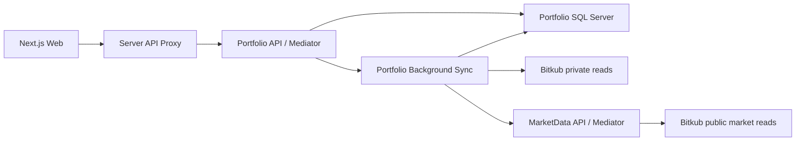

# Architecture

Quantara uses one frontend and two small services, separated by business ownership rather than one process per class.

## Boundaries

- Each service owns its Domain/Application/Infrastructure/Api projects. No project references cross service directories.
- Domain has no framework packages. Application references Domain and Mediator abstractions. Infrastructure implements Application interfaces. API composes dependencies and exposes thin controllers.
- Portfolio query handlers receive a read-only repository interface. Commands schedule import; the background job is the only account import writer.
- MarketData owns public coin/price reads and has no database or credentials. Portfolio owns account reads and SQL Server. HTTP contracts are mapped locally, never shared through another service's Domain assembly.
- Each class/record/interface/enum has its own matching file. Controllers, queries, commands, handlers, persistence and adapters are separated. Compiler/analyzers and architecture checks enforce these boundaries.

## Frontend

Routes compose screens. Components use feature hooks; hooks use API functions; API functions validate transport data with Zod. The Next.js server proxy forwards to Portfolio. Shared code never imports features or other services. One component or declared type per matching file, with Next.js route filename conventions retained.

Portfolio, history, polling, abort handling, filters, status, error recovery and formatting are separate responsibilities. UI colors, compact rows, focusable table scrolling and English copy retain DESIGN.md behavior.

## Data compatibility

The existing Quantara SQL database remains exclusively owned by Portfolio. `CryptoPortfolioLedger`, account-key SHA-256 partitioning and JSON property names are preserved. The first idempotent SQL migration only creates missing schema; it never deletes existing records. Retained closed coins and deduplicated fills survive the move.

## Execution

MarketData defaults to port 5051, Portfolio to 5050, and Web to 3000. Service addresses are configuration, not Domain dependencies. Credentials stay in Portfolio's server environment or the root .env allowlist. Startup does not authorize transactions. This slice has no orders, transfers, withdrawals, AI or RiskEngine.

CI checks are implemented, but remote branch protection is an administrator setting and is not changed by adding a workflow. Account integration and SQL checks are opt-in; default CI uses deterministic fake transports and isolated browser fixtures.

## Blank-line enforcement

C# IDE2000/IDE2003 reject consecutive blank lines and require a blank line between a completed block and the next statement. IDE0055 enforces formatter diagnostics. These Roslyn blank-line options are experimental, so SDK upgrades must retain the diagnostic probe verification.

Frontend ESLint Stylistic requires a blank line after the directive/import group, after block-like statements and before return statements, and allows at most one consecutive blank line. Editor lint and CI enforce these rules; Prettier preserves the required spacing. No rule requires an empty line between every statement.
