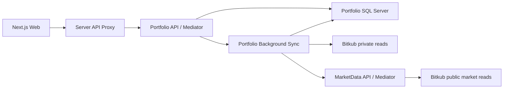

# Architecture

Quantara uses one frontend and two small services, separated by business ownership rather than one process per class.

## Boundaries

- Each service owns its Domain/Application/Infrastructure/Api projects. No project references cross service directories.
- Domain has no framework packages. Application references Domain and Mediator abstractions. Infrastructure implements Application interfaces. API composes dependencies and exposes thin controllers.
- Portfolio query handlers receive a read-only repository interface. Commands schedule import; the background job is the only account import writer.
- MarketData owns public coin/price reads and has no database or credentials. Portfolio owns account reads and SQL Server. HTTP contracts are mapped locally, never shared through another service's Domain assembly.
- Each class/record/interface/enum has its own matching file. Controllers, queries, commands, handlers, persistence and adapters are separated. Compiler/analyzers and architecture checks enforce these boundaries.

## Frontend

Routes re-export class screens. UI components extend Component/PureComponent. Each crypto component lives in its own folder with its Props/State files. The CryptoPage screen container owns lifecycle, cancellation, polling and history cache. Components obtain services through Context; they cannot import concrete clients or construct service instances. PortfolioService and HistoryService implement IPortfolioService/IHistoryService and depend on IRequestService through their constructors. The interfaces are compile-time TypeScript contracts, not runtime DI tokens. RequestService owns fetch, HTTP errors, no-store and AbortSignal propagation; feature services validate transport data with Zod. CryptoController methods are exported directly as Next.js route handlers; CryptoProxy forwards to Portfolio. Shared code never imports features or other services. One component or declared type per matching file, with Next.js route filename conventions retained.

The client ServiceProvider in app/providers is the composition root. It creates one shared RequestService and both feature services per provider lifetime, then supplies ICryptoServices through CryptoServiceContext. CryptoPage reads the typed Context with static contextType. ServiceProvider accepts optional services overrides at mount for isolated implementations/mocks. Dependencies stay stable for that provider's lifetime; remount the provider to replace the binding. No process-wide singleton or external DI package is used. Request cancellation/timers remain owned by the screen rather than shared services.

No standalone application functions or hooks are allowed; ESLint enforces this in the editor/build. Class methods and inline event/collection callbacks are permitted. RootDocument.render is the server layout adapter (Next.js invokes its exported method); client pages re-export real class components. Third-party React/Next.js/MUI implementations retain their own internals.

RequestService receives the shared base URL through its constructor (default `/api`) and joins relative resource paths with one slash. HistoryService owns `/crypto/history`; PortfolioService owns `/crypto` and appends `/portfolio` or `/sync`. Feature services do not duplicate the server address. Browser traffic still uses the same-origin Next.js proxy; broker/service addresses remain on the server.

Portfolio, history, polling, abort handling, filters, status, error recovery and formatting are separate responsibilities. UI colors, compact rows, focusable table scrolling and English copy retain DESIGN.md behavior.

## Data compatibility

The existing Quantara SQL database remains exclusively owned by Portfolio. `CryptoPortfolioLedger`, account-key SHA-256 partitioning and JSON property names are preserved. The first idempotent SQL migration only creates missing schema; it never deletes existing records. Retained closed coins and deduplicated fills survive the move.

## Execution

MarketData defaults to port 5051, Portfolio to 5050, and Web to 3000. Service addresses are configuration, not Domain dependencies. Credentials stay in Portfolio's server environment or the root .env allowlist. Startup does not authorize transactions. This slice has no orders, transfers, withdrawals, AI or RiskEngine.

CI checks are implemented, but remote branch protection is an administrator setting and is not changed by adding a workflow. Account integration and SQL checks are opt-in; default CI uses deterministic fake transports and isolated browser fixtures.

## Blank-line enforcement

C# IDE2000/IDE2003 reject consecutive blank lines and require a blank line between a completed block and the next statement. CSharpier owns whitespace and wrapping, so conflicting IDE0055 formatting diagnostics are disabled; CSharpier checks remain required in CI. These Roslyn blank-line options are experimental, so SDK upgrades must retain the diagnostic probe verification.

QNT005 requires a blank line between C# type members, including fields, constructors, properties and methods. The blank line goes before the next member's documentation or attributes. Comments alone do not substitute for a blank line. This analyzer reports errors in the editor and build.

Frontend ESLint Stylistic requires a blank line after the directive/import group, after block-like statements and before return statements, and allows at most one consecutive blank line. Editor lint and CI enforce these rules; Prettier preserves the required spacing. No rule requires an empty line between every statement.

## Typed domain and presentation

Domain statuses and trade sides use enums. JSON converters live in Infrastructure
and are configured at the API/SQL boundaries; persisted lowercase trade sides,
PascalCase ledger properties and camelCase API properties retain their contracts.
Required trade fields cannot silently become default enum values.

Frontend enums and Zod schemas validate the same wire spellings. Class
components render views through named Props; ConnectionStatusPresenter uses
explicit access modifiers and readonly state to encapsulate state precedence
and appearance. Filtering is a pure operation that returns a new array.
Nested ternaries, explicit any and non-exhaustive enum switches fail ESLint.
