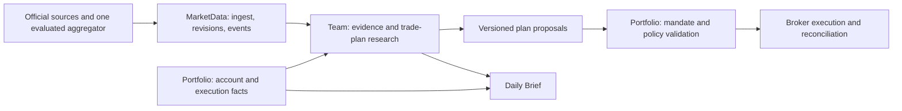

# แผนข่าว การวิจัย และการบริหารแผนเทรดของ Quantara

แผน implementation และเกณฑ์ตรวจ P0/P1; pilot ยังเป็น gate ที่เปิดอยู่

เอกสารนี้กำหนดงานถัดไปจาก `adaptive-intraday-v2` การแก้เอกสารไม่ได้เปลี่ยนกฎ เงินทุน คำสั่ง หรือสิทธิ์ AutoLive ที่ใช้อยู่

| ส่วน             | ขอบเขตและเกณฑ์ตรวจ                                                                                                 |
| ---------------- | ------------------------------------------------------------------------------------------------------------------ |
| เป้าพอร์ต        | ใช้ checkpoint จาก capital snapshot เดิม ไม่เพิ่มการเรียกบัญชี                                                     |
| เส้นทางข่าว      | ตรวจ storage/revision/HTTP/Team/UI พร้อม source health และ budget ถาวร                                             |
| สถานะแหล่งข่าว   | ตรวจ coverage/freshness/Unavailable/UnsupportedSource ต่อแหล่ง และเก็บหลักฐาน runtime แบบส่วนตัว                   |
| Coverage / pilot | ยังไม่อ้างว่าครอบคลุมข่าวเหรียญหรือผ่านการเก็บต่อเนื่อง 72 ชั่วโมง                                                 |
| P2               | โครงสร้าง assessment อ่านอย่างเดียวเตรียมไว้; ยังไม่มี frozen entry thesis รุ่นใหม่หรือการเปลี่ยน execution ของ v2 |

รุ่นนี้เริ่มเฉพาะ Bitkub THB spot การต่อ Webull หุ้น options/futures หรือ leverage เป็นงานแยก ไม่เพิ่มเข้าอำนาจเทรดผ่านฟีเจอร์ข่าว

## 1. ผลลัพธ์ที่บริษัทต้องได้

Quantara ต้องหาโอกาส ลงมือเมื่อมีหลักฐาน ดูแลสิ่งที่ซื้อ และอธิบายผลงานจากเงินจริงได้ เจ้าของเติมทุนและตรวจภาพรวม โดยไม่ต้องตั้งค่าทางเทคนิคหรือสั่งงานทีมทุกครั้ง

- ใช้ objective ปัจจุบันที่เซิร์ฟเวอร์ส่งให้สำหรับบัญชีนั้น โดยอ่าน `targetThb` และ `deadlineExclusive` จาก `objective`/`currentGoal` ตาม policy ที่กำหนดอยู่ วัด equity รวมเงินเติมทุนที่ยืนยันแล้ว ไม่ใช้ฟิลด์เป้า legacy เป็นคำสั่งบังคับกำไรในงานใหม่ และเอกสารนี้ไม่ได้เพิ่มความสามารถแก้เป้าผ่าน UI
- เป้าหมายใช้วัดช่องว่างและวางงานวิจัย ไม่ใช้บังคับซื้อ เพิ่มขนาดไม้ หรือฝ่าฝืนข้อจำกัดเพื่อให้ครบยอด เงินเติมทุนช่วยให้ถึงเป้าพอร์ตได้ แต่ต้องไม่แสดงเป็นกำไรเทรด แสดงต้นทุนข่าว/AI แยกเพื่อดูผลงานของกิจการด้วย
- ใช้ทุนและเพดานความเสี่ยงที่บันทึกและอนุญาตไว้สำหรับบัญชี ไม่ตั้งเพดานตัวอย่างแทนค่าที่ตรวจสอบได้ และไม่ขยายสิทธิ์จากการอ่านข่าว
- ข่าวต้องช่วยค้นหาโอกาสเชิงบวก พร้อมระบุเหตุการณ์ที่ทำลายสมมติฐานของการถือเหรียญ
- แต่ละการเข้า/ออกต้องย้อนดูได้ว่าเห็นข้อมูลอะไรเมื่อไร ใครเสนอแผน และกฎใดอนุญาตให้ส่งคำสั่ง
- การพัฒนาทุกวันต้องมีหลักฐานเปรียบเทียบ บทเรียนในแชตอย่างเดียวไม่ถือว่ากลยุทธ์เก่งขึ้น

### 1.1 นิยาม objective ของบัญชีที่ตรวจผลได้

| รายการ        | นิยาม                                                                                                                                                         |
| ------------- | ------------------------------------------------------------------------------------------------------------------------------------------------------------- |
| เป้าหมาย      | PortfolioEquity อย่างน้อย `targetThb` ในสกุล THB ตาม objective ปัจจุบันของบัญชี                                                                               |
| วันสิ้นสุด    | จุดตัดแบบ exclusive จาก `deadlineExclusive` ของ objective; แสดงเวลาใน Asia/Bangkok และไม่ hardcode วันส่วนบุคคลในเอกสาร                                       |
| สิ่งที่นับ    | เงินบาทรวมในบัญชีโบรกเกอร์และมูลค่าเหรียญที่ถือจริง รวมเงินเติมทุนที่โบรกเกอร์ยืนยันแล้ว                                                                      |
| ราคา          | bid/ราคาประเมินที่ตรวจแหล่งและเวลาได้ของสินทรัพย์นั้น แสดง as-of/coverage; ไม่สมมติว่าเป็นยอดขายสำเร็จ                                                        |
| เงินที่จองไว้ | ยังคงเป็นส่วนหนึ่งของยอดเงินบาทรวม ไม่บวกมูลค่า open order เพิ่มอีกครั้ง; ไม่ถือว่าเหรียญที่ยังไม่ fill เป็นสินทรัพย์ที่ซื้อแล้ว                              |
| ผลงาน         | แสดง starting equity, เงินฝาก/ถอน, realized/unrealized P&L และต้นทุนแยก เป้าพอร์ตรวมกับกำไรจากการเทรดเป็นคนละตัวชี้วัด                                        |
| ความคืบหน้า   | ยอดปัจจุบัน ช่องว่าง `max(0, targetThb - equity)` และเวลาที่เหลือ ไม่มีโควตากำไรบังคับรายวัน; objective ไม่ครบให้แสดง Unknown                                 |
| ขอบเขตบัญชี   | เริ่มจากบัญชี Bitkub ที่เชื่อมอยู่ ระบุ account scope ชัดเจน; Webull นับได้เมื่อเชื่อมข้อมูลจริงและมีอัตราแปลง THB พร้อมเวลา ไม่ประมาณยอดบัญชีที่ยังไม่เชื่อม |

เกณฑ์วัด ณ จุดตัด:

- ใช้ snapshot ล่าสุดก่อนจุดตัดที่ผ่านเกณฑ์ความสด พร้อมแสดงเวลาวัดจริง
- หากข้อมูลสินทรัพย์หรือราคาที่จำเป็นไม่ครบให้ผลเป้าเป็น Unknown ไม่ตีมูลค่าที่หายเป็นศูนย์
- ไม่ใช้ราคาหลัง `deadlineExclusive` ย้อนอ้างว่าเป้าสำเร็จ

ก่อนผ่าน P0:

1. ตรึง freshness tolerance ใน objective version
2. ตรวจให้ balances/fills/prices อยู่บนขอบเขตเวลาที่สอดคล้องกัน
3. การฝากเงินหรือ partial fill ที่คาบเกี่ยวจุดตัดต้องไม่ถูกนับทั้งเงินสดและเหรียญจากคนละ snapshot
4. หากยืนยันจุดตัดร่วมกันไม่ได้ให้แสดง Unknown พร้อมช่วงเวลาที่ตรวจได้

- การแตะ `targetThb` ก่อนกำหนดเป็นสถานะเคยถึงเป้า ยังต้องตรวจมูลค่า ณ จุดตัดของ objective
- ไม่สั่งขายทั้งหมด หยุดเทรด ต่ออายุ mandate หรือเพิ่มความเสี่ยงโดยอัตโนมัติเมื่อใกล้/ถึงเป้า
- การแก้ objective ไม่เปลี่ยน daily loss cap และขอบเขตเงินจริงเดิม

| ขอบเขต P0                  | ข้อกำหนด                                                                                   |
| -------------------------- | ------------------------------------------------------------------------------------------ |
| Business objective         | เพิ่มแยกจาก execution policy แล้วส่งนิยามเดียวกันให้ UI/AI/report                          |
| Legacy                     | ค่า `dailyProfitTargetThb` และ hash ของ v2 เดิมเป็นข้อมูล legacy ที่ต้องคงความเข้ากันได้   |
| Persisted rules/mandate สด | ห้ามแก้เพื่อเปลี่ยนข้อความเป้าหมาย                                                         |
| Context รุ่นใหม่           | ต้องแสดง objective ของบัญชีเป็นเป้าปัจจุบัน และไม่ให้ค่า legacy กลับมาเป็นคำสั่งบังคับกำไร |

`deadlineExclusive` เป็นจุดวัดเป้าธุรกิจ ไม่ใช่ข้ออนุญาตให้เร่ง promote กลยุทธ์ที่ยังประเมินไม่พอ ช่วงประเมิน 14 วันอาจเลยวันเป้าได้ ต้องรายงานความคืบหน้า/ข้อจำกัดตามจริงโดยไม่ข้ามเกณฑ์ของรุ่นใหม่

## 2. Baseline และพฤติกรรมที่ต้องตรวจ

| เรื่อง           | ระบบปัจจุบัน                                                    | ผลต่อแผนใหม่                                                               |
| ---------------- | --------------------------------------------------------------- | -------------------------------------------------------------------------- |
| ข่าว             | Codex worker ปิด network และ web search                         | ตัวรับข้อมูลบนเซิร์ฟเวอร์เป็นผู้ส่งข่าวที่ตรวจแล้วให้ AI วิเคราะห์         |
| บทบาท AI         | CEO/Analyst/Reviewer วิจัยจาก snapshot; ไม่เลือกคำสั่ง AutoLive | การเพิ่มข่าวเข้าแชตยังไม่ทำให้ข่าวมีผลต่อการซื้อขาย                        |
| การเลือกกรอบเวลา | v2 เลือก 5 แล้ว 15 แล้ว 60 นาที เมื่อข้อมูลกรอบก่อนหน้าไม่พร้อม | เป็นการเลือกตามความพร้อมของข้อมูล ยังไม่ใช่การเลือกกรอบที่เหมาะกับสภาพตลาด |
| ทางเข้า          | Breakout/Pullback/Range ตามสูตรและข้อมูลราคา/volume             | ต้องเก็บ baseline นี้ไว้เทียบ ไม่สรุปว่าเพิ่มข่าวแล้วดีขึ้นทันที           |
| ทางออก           | stop/target/trailing ตรวจราคาสด; ค่า legacy time exit 120 นาที  | ต้องแยกการป้องกันความเสียหายออกจากการทบทวนสมมติฐาน                         |
| คำสั่งทำกำไร     | ยังไม่ได้วางขายรอที่โบรกเกอร์ทันทีหลังซื้อสำเร็จ                | ต้องออกแบบวงจรยกเลิก/partial fill/ยอดถูกล็อกก่อนเพิ่ม                      |
| คุณภาพ execution | ความละเอียดจำนวนต้องคงเดิมตลอด fill/accounting/mandate/exit     | ต้องทดสอบวงจรชีวิตของ position ทั้งเส้น ไม่ตรวจเฉพาะการส่งซื้อ             |
| ผลตอบแทน         | ตรวจ realized/unrealized และต้นทุนจากหลักฐานภายในบัญชี          | การส่งคำสั่งได้ไม่ใช่หลักฐานว่ากลยุทธ์ทำกำไรได้                            |

จุดอ้างอิงสำหรับตรวจ baseline คือ `CodexTeamWorker.mjs`, `BitkubExecutionMarketReader.cs`, `AdaptiveTradingStrategy.cs` และ `TradingControl.cs` ไม่อนุมานว่าหน้าจอ Healthy หมายถึงบริษัททำเงินได้

## 3. ขอบเขตและผู้ตัดสินใจ

| ส่วน       | หน้าที่เป้าหมาย                                                    | ขอบเขตอำนาจ                                                           |
| ---------- | ------------------------------------------------------------------ | --------------------------------------------------------------------- |
| MarketData | รับข่าว/ปฏิทิน เก็บเวลา แหล่งที่มา เวอร์ชัน และจับคู่สินทรัพย์     | อ่านแหล่งสาธารณะ ไม่มีข้อมูลบัญชีหรือ broker key                      |
| Analyst    | ตรวจข้อเท็จจริง ความเกี่ยวข้อง ราคา สภาพคล่อง และหลักฐานที่ขัดกัน  | สร้างข้อวิเคราะห์ที่อ้าง event ID ได้                                 |
| Reviewer   | ตรวจข่าวเก่า ข่าวซ้ำ การอ้างเกินหลักฐาน ต้นทุน และแผนออก           | รับ/ปฏิเสธคุณภาพแผนวิจัย การผ่าน Reviewer ไม่ใช่สิทธิ์ส่งคำสั่ง       |
| CEO        | จัดลำดับโอกาส เลือกแผนเสนอ และทบทวน position ที่เกี่ยวข้อง         | ระยะแรกเป็นข้อเสนอ; บทบาทเลือกแผนเงินจริงต้องอยู่ใน policy รุ่นใหม่   |
| Portfolio  | ตรวจบัญชี/mandate คำนวณจำนวนเงิน ตรวจข้อจำกัด ส่งและกระทบยอดคำสั่ง | เป็นเจ้าของ execution และบัญชี; broker credentials อยู่ที่นี่เท่านั้น |
| เจ้าของ    | เปิดขอบเขตการทำงานหนึ่งครั้ง ดูผลงาน เติมทุน และหยุดระบบได้        | ไม่ต้องอนุมัติทุกข่าวหรือทุกไม้ภายใน mandate รุ่นที่รองรับ            |

**สิทธิ์ปัจจุบันต้องคงเดิม:** ภายใต้ mandate v2 ข่าวและ AI เป็นงานวิจัยเท่านั้น การให้ AI เลือกแผนที่มีผลต่อเงินจริงเป็นความสามารถใหม่ ต้องมีสัญญาข้อมูล policy/hash และการเปิดใช้งานใหม่จากเจ้าของ ห้ามนำ output ของ Team ไปเสียบใน AutoLive เดิมโดยเงียบ ๆ

เป้าหมายปลายทางคือ AI มีบทบาทจริงในการเสนอและเลือกแผน ส่วน Portfolio ตรวจและบังคับขอบเขตที่เจ้าของเปิดไว้ ไม่มีการมอบ broker key หรือ owner token ให้โมเดล

- policy รุ่นนั้นต้องระบุ action ที่ AI เสนอได้ รุ่น model/prompt/schema ที่ยอมรับ แหล่งข้อมูล เพดานความเสี่ยง และ fallback ให้ครบ
- แผนใหม่ภายในขอบเขตเดิมไม่ต้องรออนุมัติรายไม้
- การเปลี่ยนขอบเขตเหล่านี้เป็น material change ต้อง disarm และทบทวน mandate ใหม่ตามกฎโครงการ

## 4. รับข่าวจากที่ไหน และอะไรยังไม่ทราบ

| กลุ่ม       | จุดเริ่มต้น                                            | ใช้ทำอะไร                                                           | สิ่งที่ต้องพิสูจน์ก่อนเชื่อม                                          |
| ----------- | ------------------------------------------------------ | ------------------------------------------------------------------- | --------------------------------------------------------------------- |
| โบรกเกอร์   | ประกาศ Bitkub                                          | ระงับบริการ เปลี่ยนเงื่อนไข ซื้อขายไม่ได้ ถอดเหรียญ                 | endpoint/วิธีอ่านที่อนุญาต ความครอบคลุม การจับคู่เหรียญ และความล่าช้า |
| มหภาค       | Fed RSS/FOMC และ BLS RSS/ปฏิทิน                        | รู้กำหนดการและผลประกาศจริง                                          | parse เขตเวลา/DST เวอร์ชันแก้ไข และเวลาที่ระบบรับรู้                  |
| โครงการ     | แหล่งประกาศทางการของเหรียญที่ถือและผู้สมัครอันดับต้น   | อัปเกรด เศรษฐศาสตร์โทเคน เหตุขัดข้อง และเหตุการณ์ที่มีผลต่อสมมติฐาน | ยืนยันโดเมน/โครงการ ไม่ใช้ ticker ตรงกันอย่างเดียว                    |
| ข่าววงกว้าง | ประเมิน aggregator เพียงหนึ่งรายหลังเห็นตัวอย่างข้อมูล | ค้นหาเหตุการณ์นอก watchlist และหาต้นฉบับ                            | สิทธิ์ใช้ข้อมูล latency โควตา ค่าใช้จ่าย ประวัติ และการแก้ข่าว        |

หลักฐานและช่องว่างรายแหล่ง:

- **Fed / BLS:** Fed มี RSS และปฏิทิน FOMC ทางการ; BLS มี RSS และปฏิทินเผยแพร่ที่อัปเดตได้ ใช้ปฏิทินเพื่อรู้เวลา ไม่ถือว่าผลประกาศออกแล้วหรือรู้ค่าตัวเลขล่วงหน้า ([Fed RSS](https://www.federalreserve.gov/feeds/feeds.htm), [FOMC](https://www.federalreserve.gov/monetarypolicy/fomccalendars.htm), [BLS RSS](https://www.bls.gov/feed/), [BLS calendar](https://www.bls.gov/schedule/news_release/empSit.htm))
- **Bitkub:** ตรวจ endpoint/สิทธิ์ใช้และ payload ของหน้า support/ประกาศก่อนใช้ใน production ห้ามสมมติว่ามี RSS/API ข่าวที่พร้อมใช้โดยไม่มีหลักฐาน ([Bitkub Support](https://support.bitkub.com/en/solutions?Id=151000093916))
- **GDELT DOC API:** เป็นตัวเลือกค้นพาดหัว/ลิงก์ข่าว ต้องประเมินความเกี่ยวข้องและความล่าช้าจากตัวอย่างจริงก่อนเลือก ([GDELT DOC documentation](https://blog.gdeltproject.org/gdelt-doc-2-0-api-debuts//))
- **CryptoPanic:** ต้องตรวจเอกสารและสิทธิ์ใช้ก่อนผูกระบบกับราคา โควตา หรือ SLA ของรายนั้น

เริ่มจากแหล่งทางการที่อ่านได้จริง ใช้สิทธิ์/แพ็กเกจเดิมก่อน ไม่มีการสมัครบริการเสียเงินในแผนนี้ ข่าว social และ sentiment จำนวนมากยังไม่อยู่ในรุ่นแรก

## 5. สัญญาข้อมูลข่าวและคุณภาพหลักฐาน

แต่ละข่าวต้องมีข้อมูลต่อไปนี้ โดยฟิลด์ที่ไม่ทราบเป็น Unknown ไม่สร้างค่าทดแทน:

- ตัวตน: source ID, provider item ID, canonical URL, event ID, revision, content hash และต้นทางที่อ้างต่อกัน
- เวลา: `publishedAt`, `firstSeenAt`, `fetchedAt`, `updatedAt`; เพิ่ม `occurredAt`/`effectiveAt` เมื่อแหล่งข่าวระบุ แยกเวลาเกิดเหตุออกจากเวลาเผยแพร่
- สินทรัพย์: project/instrument identity, exchange pair ที่เกี่ยวข้อง, ความมั่นใจของการจับคู่ และเหตุผล การพาดหัวว่า ONE/OP ไม่เพียงพอให้จับคู่เหรียญ
- ประเภท: Listing/Delisting, SecurityIncident, NetworkChange, TokenSupply, Regulation, MacroRelease หรือ Other
- สถานะข้อเท็จจริง: FirstPartyClaim, Corroborated, Unverified, Disputed, Corrected, Retracted; เป็นประกาศทางการไม่ได้แปลว่าเกิดผลตอบแทนเชิงบวกแน่นอน
- ความเกี่ยวข้อง: เฉพาะสินทรัพย์/โบรกเกอร์/ทั้งตลาด ระบุขอบเขต ไม่ขยายข่าวของโครงการเดียวเป็นสัญญาณของทุกเหรียญ
- อายุใช้งาน: เวลาที่ข้อประเมินหมดอายุ กับวันที่เหตุการณ์มีผลเป็นคนละค่า ข่าวเก่าหรือข่าวที่ผลสะท้อนไปแล้วต้องไม่ถูกเสนอเหมือนเพิ่งเกิด
- เนื้อหา: เก็บ metadata และข้อความเท่าที่สิทธิ์ของแหล่งข้อมูลอนุญาต ไม่คัดลอกบทความเต็มโดยอัตโนมัติ

| กรณีรับข้อมูล        | กติกา                                                                                                                                                                              |
| -------------------- | ---------------------------------------------------------------------------------------------------------------------------------------------------------------------------------- |
| ข่าวเดียวหลายรูปแบบ  | รองรับข่าวเดียวหลายสำนัก ข่าวแปล ข่าวแก้ไข การเผยแพร่ซ้ำ และ restart; ข่าว 20 ลิงก์ที่คัดจากแหล่งเดียวไม่ใช่การยืนยันอิสระ 20 ครั้ง เก็บ revision เดิมเพื่อ replay ได้             |
| Catch-up หลังระบบดับ | เก็บข่าวย้อนหลังได้ แต่ห้ามเปลี่ยนพาดหัวเก่าให้เป็น fresh alert เพราะเพิ่งดึงถึง ต้องพิจารณาว่าเป็นเหตุการณ์เก่าที่จบแล้ว ข้อเท็จจริงที่ยังมีผล หรือประกาศอนาคตที่ยังไม่ถึงวันมีผล |
| ไม่มีเวลาเผยแพร่     | ใช้ `firstSeenAt` เป็นเวลาที่ระบบเริ่มนำไปใช้ได้ พร้อมระบุว่าเวลาต้นฉบับไม่ทราบ ห้ามย้ายเวลาให้ดูเหมือนระบบเห็นข่าวเร็วกว่าจริง                                                    |

## 6. ข่าวจะเปลี่ยนงานบริษัทอย่างไร

| เหตุการณ์                         | สิ่งที่ทีมต้องทำ                                                  | ผลที่ต้องบันทึก                                                    |
| --------------------------------- | ----------------------------------------------------------------- | ------------------------------------------------------------------ |
| ข่าวสนับสนุนเหรียญที่ยังไม่ได้ถือ | ตรวจต้นฉบับ ขอราคา/กรอบเวลา/สภาพคล่อง แล้วเปรียบเทียบกับโอกาสอื่น | แผนเข้า หรือเหตุผลที่ยังไม่มีจังหวะพร้อมเงื่อนไขตรวจใหม่           |
| ข่าวกระทบเหรียญที่ถือ             | นำสมมติฐานตอนซื้อเทียบข้อเท็จจริงใหม่ก่อนงานวิจัยทั่วไป           | Keep/Reduce/Exit/Review พร้อมหลักฐานและระยะเวลาที่ข้อประเมินใช้ได้ |
| ข่าวลือหรือข้อมูลขัดกัน           | ระบุข้อขัดแย้ง หาต้นฉบับ และจำกัดข้ออ้างตามข้อมูล                 | Unverified/Disputed ไม่ตีความว่าเป็นข่าวลบโดยอัตโนมัติ             |
| ใกล้ประกาศตัวเลขเศรษฐกิจ          | ระบุเวลา ประเภทเหตุการณ์ และ playbook ที่ policy รองรับ           | เงื่อนไขก่อน/หลังประกาศ ไม่สั่งรอทั้งตลาดแบบไม่มีกำหนด             |
| ไม่มีข่าวใหม่                     | วิเคราะห์สัญญาณราคาและ position ตามงานปกติ                        | No new relevant events ไม่ใช่ข่าวหายหรือไม่มีโอกาส                 |
| แหล่งข่าวล่ม                      | แสดงแหล่งที่ขาดและผลกระทบต่อข้ออ้างที่ต้องพึ่งแหล่งนั้น           | ไม่ใช้ข่าว cache หมดอายุ และไม่หยุดสแกนทุกเหรียญโดยปริยาย          |

ข่าวบวกไม่ใช่คำสั่ง Buy; ต้องแสดงว่ามีจังหวะเข้าที่ต้นทุนและการออกสมเหตุสมผลหรือยัง ข่าวลบไม่ใช่คำสั่งขายทุก position โดยไม่มีขอบเขต การยืนยันเหตุซื้อและความสามารถส่งคำสั่งต้องตรวจแยกกัน

เมื่อทีมตอบ Wait ต้องระบุสิ่งที่รอ ราคาหรือเหตุการณ์ใดทำให้พิจารณาใหม่ และเวลาทบทวนถัดไป รายงานต้องมีเหตุผลของการถือเงินสดและผู้สมัครที่ถูกปฏิเสธ ไม่วนข้อความว่า “ข้อมูลไม่ครบ” โดยไม่ระบุฟิลด์

## 7. แผนเทรดที่ยืดหยุ่นและตรวจสอบได้

แยกการเปลี่ยนทางออกกับการเพิ่มข่าวเป็นคนละรุ่นทดลอง เพื่อรู้ว่าอะไรทำให้ผลเปลี่ยน

**สัญญาแผนที่เสนอ** ต้องผูก account, policy hash, instrument, plan ID/revision, model/prompt/schema version และ evidence IDs โดยมี:

- Thesis: ซื้อเพราะอะไร สิ่งใดสนับสนุน/คัดค้าน และมีข่าวเกี่ยวข้องหรือไม่มี
- Entry: กรอบเวลา trigger ราคา limit อายุคำสั่ง และสมมติฐานต้นทุน; Portfolio คำนวณจำนวนจากยอดเงินจริงและเพดานเดิม
- Context: ภาพตลาดกรอบใหญ่และกรอบเข้า แยกจาก “ข้อมูลกรอบสั้นไม่มีจึงใช้กรอบใหญ่แทน”; ข่าวไม่สร้างแท่งข้อมูลที่หาย
- Protective exit: จุดป้องกันความเสียหายที่ engine ตรวจราคาสดได้โดยไม่รอ AI
- Thesis exit: เงื่อนไขที่แผนเสีย เช่น ปิดแท่งหลุดโครงสร้าง ใช้หลักฐาน/กรอบเวลาที่ระบุ ไม่ใช้คำว่า “ดูไม่ดี”
- Profit plan: ราคาเป้าหมายและแผนดูแลคำสั่งที่วางรอ รวม trailing หาก policy รองรับ
- Review: `reviewAfter` กับ `maximumHoldingDeadline` แยกกัน การถือครบ 120 นาทีควรเป็นสมมติฐานสำหรับทดลองจุดทบทวน ไม่เปลี่ยนไม้เดิมให้ถือยาวอัตโนมัติ
- Expiry: แผนหมดอายุเมื่อไร ข้อมูลใดต้องสด และ fallback ที่ล็อกไว้หาก AI ทบทวนไม่ทัน

วงจรและสถานะแผน:

1. ต้อง freeze entry thesis ก่อนส่งซื้อและเชื่อมกับ intent/fill ที่ยืนยันแล้ว
2. การเสนอ revision หลังซื้ออ้าง revision ก่อนหน้าและ position เดิม ไม่สร้างเหตุซื้อย้อนหลังเพื่อให้คำตัดสินดูถูกต้อง

- สถานะแผนต้องแยก Draft, Validated, Accepted, Superseded, Expired และ Rejected
- การส่งซ้ำไม่สร้างแผนหรือออเดอร์ใหม่
- แผนถูก supersede ต้องไม่ออกคำสั่งทับแผนที่ส่งไปแล้ว

| ขอบเขตการรับแผน                   | ข้อกำหนดของ Portfolio                                                                                                             |
| --------------------------------- | --------------------------------------------------------------------------------------------------------------------------------- |
| เงื่อนไขที่รับ                    | เฉพาะเงื่อนไขแบบ typed ที่ policy ระบุ เช่น setup ID/รุ่น, completed-candle threshold, limit/stop price, review time และ deadline |
| สิ่งที่ไม่รับ                     | โค้ด สูตรใหม่ หรือคำสั่งภาษาธรรมชาติที่ engine ต้องเดา                                                                            |
| Concurrency                       | ใช้ expected revision/CAS และหนึ่ง active plan ต่อ position; intent ผูกกับ revision ที่ยอมรับแล้ว                                 |
| การเปลี่ยนแผน/ยกเลิก/จับคู่คำสั่ง | ต้องใช้ state transition ที่กระทบยอดได้                                                                                           |

- แผนหมดอายุ ข่าวถูกถอน หรือหลักฐานที่จำเป็นต่อแผน stale จะห้ามเพิ่ม exposure จากแผนนั้น แต่ไม่ลบ protective rules ของ position ที่ซื้อไปแล้ว
- หลักฐานที่เป็นเพียงข้อมูลเสริมขาดไม่ขวางแผนอื่น
- การป้องกัน position ใช้แผนที่ commit ไว้ภายใต้ mandate ที่ยังมีผล
- เมื่อ mandate หมดอายุหรือเจ้าของ Disable ต้องเคารพการ disarm เดิม ไม่ใช้อายุ position มาอ้างสิทธิ์ส่งคำสั่งต่อ
- คำสั่งที่ฝากไว้กับโบรกเกอร์อาจยังเปิดอยู่และต้องแสดงตามจริง

สิ่งที่ต้องพิสูจน์ก่อนใช้แผนใหม่:

1. ระยะ stop เหมาะกับโครงสร้าง ความผันผวน spread และต้นทุนของเหรียญนั้น แยก stop แคบจากกราฟสั้นออกจากภาวะที่สมมติฐานเสียจริง
2. ทดลองทางออกแบบยืนยันแท่งเฉพาะ thesis exit ขณะที่ protective exit ยังตรวจราคาสด ไม่เลื่อนการป้องกันทั้งหมดไปรอแท่งปิด
3. AI เสนอทบทวนได้ แต่ห้ามยืด hard loss limit เพื่อหลีกเลี่ยงการรับรู้ขาดทุน แผนที่ไม่มีหลักฐานใหม่ไม่ขยายอายุเอง
4. หากถึงเวลาทบทวนแล้ว AI ใช้งานไม่ได้ ใช้ fallback/เส้นตายที่ policy กำหนด ไม่ตีความความเงียบเป็นคำอนุมัติให้ถือหรือเพิ่มความเสี่ยง
5. อนุญาตเข้าใหม่/เพิ่มไม้เฉพาะที่ policy รุ่นนั้นรองรับ พร้อมหลักฐานใหม่ cooldown และการนับ exposure ที่ถูกต้อง

แผนนี้ไม่กำหนดตัวเลข stop/ATR/เวลาถือใหม่ว่าเหมาะที่สุด ต้องวัดด้วยข้อมูลและต้นทุนจริงก่อนตรึงค่าของรุ่นที่จะเปิดใช้

การทดลองหลายกรอบเวลา:

- ต้องดึงแท่ง native ของแต่ละกรอบจริง โดยแยก readiness ของกรอบเข้าและกรอบบริบทออกจากกัน ไม่เพียงเปลี่ยนชื่อ timeframe ของชุดเดิม
- ดึงรายละเอียดหลายกรอบเฉพาะ position/ผู้สมัครสำคัญภายในโควตา
- universe scan ยังหมุนเวียนได้ และไม่บล็อกทุกจังหวะเพียงเพราะ indicator ที่เป็นข้อมูลเสริมขาด

## 8. วงจรส่งคำสั่งและวางขายรอ

ทำเป็นงาน execution แยกที่มี acceptance ของตัวเอง ไม่ถือว่าต่อข่าวแล้วปัญหาทางออกจะหาย

- ซื้อยืนยัน fill แล้วจึงคำนวณจำนวนที่ขายได้จากหน่วยจริงและยอด available; partial buy ยังไม่ใช่ซื้อครบ
- หาก policy ใหม่รองรับ วาง take-profit LIMIT รอที่โบรกเกอร์ พร้อมบันทึก broker ID และ durable claim
- เมื่อต้องออกก่อนเป้าหมาย ตรวจ partial fill ยกเลิกคำสั่งเดิม และยืนยันยอดที่ปลดล็อกก่อนส่งขายส่วนที่เหลือ
- ยกเลิกไม่แน่นอนหรือส่งขายไม่ทราบผล: กระทบยอดแบบอ่านอย่างเดียว ห้ามส่งซ้ำและห้ามขายทับจำนวนที่ยังถูกล็อก
- ออกแบบการแข่งขันระหว่าง target fill, stop trigger, manual trade และ Disable ไม่ให้ยอดขายเกิน ownership
- ตรวจว่าโบรกเกอร์รองรับ native stop/OCO หรือไม่จากสัญญาจริงก่อนออกแบบใช้ ห้ามอ้างว่ามีคำสั่งป้องกันอยู่ที่โบรกเกอร์หากยังเฝ้าด้วยแอป
- หากไม่มี atomic OCO ต้องระบุช่วงรอยืนยันยกเลิกและความเสี่ยงที่ขายออกไม่ทัน LIMIT อาจไม่ถูกจับคู่; stop price ไม่ใช่ราคาขายที่รับประกัน
- ทดสอบความละเอียดจำนวนทั้งซื้อ บันทึก fill เปิด mandate ส่งขาย ยกเลิก และปิด position โดยเก็บ raw evidence กับต้นทุนเดิม

## 9. โครงสร้างที่ใช้กับระบบเดิม

เส้นทาง Plans ไป Portfolio เป็นส่วนของ policy ใหม่เท่านั้น ในระยะวิจัยต้องจบที่รายงาน ไม่ต่อเข้าเส้นทางส่งคำสั่งเดิม

- ใช้ C#/Mediator/CQRS และชั้น Domain/Application/Infrastructure/Api เดิม ไม่เพิ่ม message broker, vector database หรือ orchestrator ใหม่ในรุ่นแรก
- MarketData เป็นเจ้าของข่าวสาธารณะและสถานะการรับข้อมูลในฐานของตัวเอง ใช้ logical records สำหรับ sources/cursors, items/revisions และ normalized events ไม่เก็บ account key ในข้อมูลข่าวสาธารณะ
- Team เป็นเจ้าของข้อประเมิน แผนเสนอ และบทเรียนต่อ account/run เก็บ event references ใน TeamRuns เดิมเมื่อเหมาะสม; เพิ่มตารางเฉพาะเมื่อแผนต้องมี lifecycle และ concurrency แยกจริง
- Portfolio เก็บเฉพาะแผนที่ยอมรับภายใต้ policy ของบัญชีนั้นและ execution evidence ใช้ durable claims/notifications เดิม ไม่ให้ Team เขียนฐาน Portfolio
- HTTP contracts มี version และ validation ในแต่ละบริการ ห้ามอ้างอิง assembly หรืออ่านฐานของอีกบริการ
- อัปเดต snapshot/prompt และ AGENTS/SKILL ของทั้งสามบทบาทพร้อมกันให้ตรงกับข่าวที่ส่งจริง ไม่บอกว่า AI เปิดเว็บเอง ทดสอบ legacy JSON/strict deserialization และ rollback reader; หาก reader เดิมอ่าน metadata ใหม่ไม่ได้ ให้เก็บ assessment แยก ไม่คลาย validation ทั้งระบบ
- migration เป็น additive คงบัญชีเดิม ประวัติ และ Unknown cost/profit; schema rollback ต้องไม่ลบข่าว/แผน/คำสั่งที่บันทึกแล้ว
- คงกฎหนึ่งชนิดต่อไฟล์และ class-based React/Context/lazy ServiceContainer ไม่มี UI ใหม่สำหรับตั้งค่าทุกพารามิเตอร์

## 10. จังหวะทำงาน ต้นทุน และความทนทาน

ค่าต่อไปนี้เป็นค่าเริ่มต้นทางวิศวกรรมสำหรับทดสอบ ไม่ใช่ SLA ของผู้ให้ข่าวหรือค่าที่พิสูจน์ผลตอบแทน:

| งาน                  | แนวทางเริ่มต้น                                                                                                                                             |
| -------------------- | ---------------------------------------------------------------------------------------------------------------------------------------------------------- |
| รับ feeds            | ตรวจทุก 1–5 นาทีตามข้อจำกัดผู้ให้บริการ ใช้ ETag/Last-Modified/Retry-After และ backoff รายแหล่ง                                                            |
| ปฏิทิน               | ตรวจตามรอบและเมื่อแหล่งอัปเดต แปลงเขตเวลา/DST ด้วยข้อมูลต้นฉบับ ไม่ hardcode เวลาไทยตลอดปี                                                                 |
| ข่าวใหม่             | บันทึก durable event ก่อนปลุกทีม รวมข่าวซ้ำและ revision ที่ไม่เปลี่ยนสาระ                                                                                  |
| จัดลำดับ             | ถืออยู่ก่อน ตามด้วยเหตุการณ์สำคัญและโอกาสใหม่ที่มีตลาดรองรับ สงวนโอกาสให้เหรียญนอก watchlist เดิม                                                          |
| รอบ AI ระยะแรก       | ใช้ hourly review และ 15-minute cooldown เดิม ไม่มีรอบซ้อน ข่าวที่รับได้เร็วไม่ได้แปลว่า AI ประเมินเสร็จทันที                                              |
| รอบเร่งด่วนรุ่นถัดไป | ต้องออกแบบ priority/coalescing และงบแยกก่อนเปลี่ยน cooldown ไม่ปลุกรอบเต็มทุกพาดหัว                                                                        |
| จำกัด context        | ส่งเฉพาะเหตุการณ์ใหม่ที่เกี่ยวข้อง เริ่มไม่เกิน 5 เหตุการณ์/4,000 ตัวอักษรต่อรอบภายในงบ context รวมเดิม ระบุสิ่งที่ตัดออกและอ่านรายละเอียดเพิ่มเมื่อจำเป็น |
| ใช้บทวิเคราะห์ซ้ำ    | cache ตาม event revision, model/prompt/schema และ market/account context; ใช้ข้อเท็จจริงซ้ำได้แต่ไม่ใช้แผนที่หมดอายุซ้ำ                                    |
| วัดต้นทุน            | จำนวนรอบ tokens/usage ที่วัดได้ latency และค่าข้อมูลจริง ค่าใดวัดไม่ได้แสดง Unknown ไม่ประมาณว่าใช้ฟรีเพราะใช้บัญชีล็อกอิน                                 |

Budget ต้องบังคับได้ทั้งจำนวนรอบ/attempt และ usage ที่วัดได้ รวมรอบปกติ ข่าว รอบเร่งด่วน และ retry ไม่ใช่จำกัดเพียงขนาด prompt:

| ค่าเริ่มต้นสำหรับ pilot       | เพดาน / กติกา                                                 |
| ----------------------------- | ------------------------------------------------------------- |
| Company rounds ต่อวัน Bangkok | รวมไม่เกิน 32 รอบ                                             |
| Rolling hour                  | ไม่เกิน 2 รอบ                                                 |
| Open-position reviews         | กัน 8 รอบรายวัน                                               |
| Role calls                    | หนึ่งรอบอาจมี 3 role calls และทุก attempt ต้องถูกนับก่อนเรียก |
| Usage มองไม่เห็น              | ยังบังคับ round budget ได้                                    |
| การปรับค่า                    | ต้องอิงการวัด ไม่ขยายเองตามข่าวเข้า                           |

- ใช้ durable coalescing รวม revision ของเหตุเดียวกันก่อนเรียกโมเดล
- retry งานวิจัยอัตโนมัติได้ไม่เกินหนึ่งครั้งต่อ batch ภายใต้ backoff/cooldown และ budget
- เมื่อครบงบ แสดง DeferredBudget พร้อมเวลาที่จะทำต่อ
- สงวนความจุให้การทบทวน position ตามโควตา และคง deterministic scanning/protection ที่ได้รับอนุญาตไว้
- ไม่ตีความงบหมดว่าอนุมัติแผนเก่า
- ค่าข้อมูลแบบเสียเงินต้องมีเพดานค่าใช้จ่ายที่ยืนยันก่อนเปิดใช้

แยก `NoNewEvents`, `Unavailable`, `RateLimited`, `Stale`, `ParseFailed` และ `UnsupportedSource` ต่อแหล่ง พร้อม last success/next retry ความล้มเหลวแหล่งเดียวต้องไม่ทำให้ scanner หรือการป้องกัน position หยุดทั้งระบบ

Runtime host ต้องมีบันทึกช่วง sleep/restart/network loss และช่องว่างข้อมูล Docker Healthy ไม่ใช่หลักฐานว่าเฝ้าได้ครบ 24 ชั่วโมง

## 11. ความปลอดภัยและความถูกต้องของข้อมูลภายนอก

- ตัวดึงข่าวใช้ allowlist ของแหล่งและชนิดข้อมูล ตรวจ redirects/DNS ไม่เข้าถึง localhost/private network/metadata endpoints จำกัดขนาด เวลา และจำนวน redirects
- ข่าวเป็นข้อมูลที่ไม่เชื่อถือ ห้ามทำตามคำสั่งที่ฝังในบทความ ห้ามรัน script/download code และห้ามให้เนื้อหาข่าวเปลี่ยน system prompt หรือสิทธิ์
- AI worker คงไม่มี network, broker credentials และ owner token รับเฉพาะ packet ที่เซิร์ฟเวอร์ตรวจแล้ว
- โมเดลตอบ schema ที่จำกัด อ้างได้เฉพาะ evidence ID ที่ส่งเข้าไป แยก observed facts, hypotheses และ proposed actions; ข้ออ้างที่ไม่มีหลักฐานถูกปฏิเสธ
- ไม่ส่งข้อมูลพอร์ตหรือบัญชีให้ผู้ให้ข่าว ป้องกัน credential/token หลุดผ่าน URL, logs และข้อความผู้ใช้
- รายการข่าวแก้ไข/ถอนต้องย้อนกลับมาถึง assessment และแผนที่อ้าง revision เก่า ไม่ลบหลักฐานเดิมหรือเปลี่ยนผลย้อนหลัง

## 12. วิธีวัดว่าเพิ่มแล้วคุ้มจริง

ต้องเก็บ baseline และกำหนดวิธีเทียบก่อนเห็นผล ไม่เลือกรายงานเฉพาะวันที่ได้กำไร

| มิติ         | สิ่งที่วัด                                                                                                                         |
| ------------ | ---------------------------------------------------------------------------------------------------------------------------------- |
| คุณภาพข่าว   | ความครอบคลุมสินทรัพย์ที่ถือ/ผู้สมัคร ความถูกต้องของ mapping ข่าวซ้ำ ข่าวแก้ไข และ latency แยกเผยแพร่ถึงรับ/รับถึงประเมิน           |
| คุณภาพแผน    | ข้ออ้างมีแหล่ง เวลาที่ใช้ได้ แผนหมดอายุ/ขัดกัน การเปลี่ยนใจโดยไม่มีหลักฐาน และจำนวน Wait ที่ไม่มี trigger ตรวจใหม่                 |
| การทำงาน     | signal → proposal → accepted → submitted → partial/filled → closed พร้อมเหตุปฏิเสธในแต่ละขั้น                                      |
| ผลเทรด       | realized net หลัง fee/credit, unrealized แยก, expectancy ต่อดีล, win/loss size, drawdown, holding time, turnover และ slippage จริง |
| ผลของบริษัท  | กำไรเทรด ลบค่าข้อมูล/AI ที่จ่ายจริง โดยไม่ปนเงินฝาก/ถอนกับกำไร และไม่หักต้นทุนซ้ำ                                                  |
| ค่าเสียโอกาส | โอกาสที่ระบบเห็น ณ เวลานั้นและทำได้ภายใต้งบ/ข้อจำกัดจริง แสดงผลสมมติแยกจากบัญชี ไม่ใช้ราคาต่ำสุด/สูงสุดย้อนหลังเป็นกำไรที่ควรได้   |

- รายงานทางออกเพิ่มเวลาตั้งแต่ trigger/decision/submit/fill ระยะติดค้าง และการแกว่งที่สังเกตได้ก่อนออก เพื่อแยก stop ไม่เหมาะจากส่งขายล่าช้า
- Objective ของบัญชีวัด equity รวมเงินเติมทุนที่ยืนยันแล้ว ส่วนการประเมินฝีมือเทรดต้องหักผลของเงินฝาก/ถอนออก
- แสดงขาดทุนที่ยังไม่ปิดด้วย ไม่ใช้ยอด realized หรือยอดเติมทุนทำให้ผลงานเทรดดูดีกว่าจริง

เปรียบเทียบอย่างน้อย 3 แขนบนช่วงข้อมูล/ทุน/ต้นทุนเดียวกัน เพื่อแยกผลของแต่ละการเปลี่ยน:

| แขนทดลอง       | รุ่น                     |
| -------------- | ------------------------ |
| Baseline       | v2                       |
| Exit           | รุ่นปรับ exit อย่างเดียว |
| News / AI plan | รุ่นเพิ่มข่าว/แผน AI     |

- ทั้งสามแขนทดลองต้องรับ forward point-in-time stream เดียวกัน ใช้ fill/capital/cost model แบบ conservative เดียวกัน และแยก book เริ่มต้นด้วยทุน/กระแสเงินเข้าเดียวกัน
- ไม่เอายอดเงินที่ v2 ใช้ไปแล้วมาเป็นทุนของแขนอื่น
- เก็บผลเงินจริงของ v2 เป็นอีกชุดสำหรับกระทบยอด
- ห้ามเทียบกำไร fill จริงของ v2 กับ fill สมมติของรุ่นใหม่แล้วอ้างว่า AI ชนะเพราะข่าว

- ประวัติข่าวที่ดึงวันนี้พิสูจน์ไม่ได้ว่าเราเห็นข่าวนั้นในอดีต ใช้ revision และ `firstSeenAt` ที่เก็บเองสำหรับการประเมินตามเวลา
- โมเดลอาจรู้ผลอดีตจากการฝึกอยู่แล้ว จึงไม่ถือ replay ข่าวเก่าเป็นการพิสูจน์ out-of-sample; การประเมินแผน AI ล่วงหน้าที่ freeze ก่อนผลเกิดสำคัญกว่า

| การทบทวนเบื้องต้น | เกณฑ์                                                |
| ----------------- | ---------------------------------------------------- |
| ระยะเก็บผลคู่ขนาน | 14 วัน โดยไม่หยุด baseline ที่มี mandate ใช้ได้      |
| โอกาส             | อย่างน้อย 30 โอกาสที่ไม่ซ้ำ                          |
| สภาพตลาด          | อย่างน้อย 2 สภาพตลาด                                 |
| ข้อมูลไม่พอ       | ระบุ Insufficient evidence พร้อมเหตุผลและงานแก้เฉพาะ |

- ตัวเลขนี้เป็นขั้นต่ำเพื่ออ่านรายงาน ไม่ใช่หลักฐานทางสถิติว่ามี edge
- ห้ามบังคับสร้างดีลหรือ promote เพียงเพราะครบวัน

ก่อนเริ่มรอบประเมินต้องตรึง version, ช่วงเวลา, วิธี fill, treatment ของ unknown, เงินทุน/ต้นทุนที่ใช้ และเกณฑ์ยอมรับ drawdown/ภาระงาน/ต้นทุน เกณฑ์ที่จะเปลี่ยนเงินจริงต้องมีตัวเลขที่ทบทวนแล้ว ไม่ใช้การชนะครั้งเดียวหรือคำรับรองของโมเดล

## 13. หน้า Daily Brief และ Telegram

- หน้าแรกของ Daily Brief ยังเป็นสถานะเทรด เพิ่มแถวสั้น `News context` เช่น เหตุการณ์เกี่ยวข้อง/เวลาอัปเดต/แหล่งข้อมูลขาด โดยพับรายละเอียดไว้
- แสดง objective ปัจจุบันของบัญชีจาก `targetThb`/`deadlineExclusive` พร้อม `Portfolio value`, `Remaining` และวันสิ้นสุด แยก `Deposits` กับ `Trading P&L` ไม่ใช้เป้า legacy แทน objective ใน UI/AI/report รุ่นใหม่
- แต่ละ position เปิดดู `Why this trade` ได้: เหตุซื้อ เหตุการณ์ที่อ้าง แผนออก สิ่งที่เปลี่ยน และเวลาทบทวนถัดไป
- แชตทีมตอบไทยสั้น: พบอะไร / ส่งผลต่อแผนอย่างไร / จะทำหรือตรวจอะไรต่อ พร้อมกดอ่านแหล่งข่าว ไม่แปะบทความยาว
- App labels เป็น English คง class components, keyboard access และ inspection จอใหญ่/แท็บเล็ต/มือถือ
- Telegram คงส่งเฉพาะซื้อ/ขายที่ยืนยัน fill แล้วตามที่เจ้าของขอ ไม่เพิ่มข่าวรายพาดหัวหรือคำขออนุมัติทุกไม้ การแจ้งเหตุขัดข้องทาง Telegram เป็นความต้องการแยกที่ยังไม่ได้เลือก
- ไม่เพิ่มฟอร์มกรอกเหรียญ แหล่งข่าว และพารามิเตอร์ทุกครั้ง ค่าเริ่มต้นมาจาก source registry และ policy ที่ตรวจแล้ว

## 14. ลำดับทำงานและเกณฑ์จบแต่ละช่วง

P3 ทดลองทางออกและกรอบเวลาในสภาพแวดล้อมประเมินแยกเท่านั้น v2 จริงยังทำงานตามเดิม การใช้ stop/review/deadline หรือ resting take-profit แบบใหม่กับเงินจริงต้องมี policy รุ่นใหม่และ mandate ที่เจ้าของเปิด เช่นเดียวกับ P5 แม้ยังไม่ใช้ข่าวเลือกคำสั่งก็ตาม

| ช่วง                    | งานส่งมอบ                                                                              | เกณฑ์ผ่านที่ตรวจได้                                                                                                        |
| ----------------------- | -------------------------------------------------------------------------------------- | -------------------------------------------------------------------------------------------------------------------------- |
| P0: ตรึงหลักฐาน         | baseline + decision/position review contract + ยืนยันว่าทางออกไม่ติดขัด                | อธิบายดีลจริงได้จากข้อมูล ณ เวลานั้น; regression ซื้อ/ขาย/เปิดใหม่/partial/unknown ผ่าน; ไม่มีการเปลี่ยน live rules        |
| P1: ข่าวครบเส้นทาง      | source ที่ตรวจใช้ได้ → storage/revision → HTTP snapshot → AI assessment → Daily Brief  | ข่าวอ้างกลับได้ restart ไม่ซ้ำ ข่าวเก่า/แก้ไข/mapping กำกวมแยกได้ และมี source outage state; ไม่มี broker mutation จากข่าว |
| P2: ประเมินทุก position | thesis ตอนเข้า + ข่าว/กราฟใหม่ + Keep/Reduce/Exit/Review ที่มีอายุ                     | ข้อเสนออ้างหลักฐานครบ ไม่เพิ่มความเสี่ยงจากข้อมูลหาย; AI ล่มไม่ทำให้ engine ล่ม; ประเมินโอกาสใหม่ได้ด้วย                   |
| P3: ทางออกและกรอบเวลา   | แยก protective/thesis/review/deadline; ทดลองบริบทกรอบใหญ่; lifecycle take-profit รอขาย | ข่าวยังไม่ขยายอำนาจ; fake broker พิสูจน์ cancel/fill race และยอดล็อก; อธิบายเหตุออก/ถือได้ ไม่มี retry เมื่อผลไม่แน่นอน    |
| P4: วัดผลคู่ขนาน        | รายงาน baseline/exit/news ตามเกณฑ์ที่ freeze                                           | ผลกำไรจริงกับผลทดลองแยก; ไม่มี lookahead ผ่าน timestamps/revisions; จบด้วย Accept/Reject/Insufficient evidence พร้อมเหตุผล |
| P5: ให้แผนมีผลเงินจริง  | policy รุ่นใหม่ + bounded plan consumption ใน Portfolio                                | contract/expiry/account/hash/risk/idempotency ผ่าน; v2 เดิมไม่รับแผน AI; เจ้าของเปิด mandate ใหม่หนึ่งครั้งในแอป           |
| P6: ทบทวนทุกวัน         | รายงานผลงานจริง เหตุ Wait/เสียโอกาส และข้อทดลองถัดไป                                   | บทเรียนเชื่อมหลักฐาน ไม่มีการแก้ prompt/risk/strategy หรือ promote เองกลางวันโดยไม่มี version และขั้นตรวจ                  |

### Checklist งานแรกที่พร้อมเริ่ม

- [x] P0 แยก objective ของบัญชีใน UI/AI/report รวมเงินเติมทุนที่ยืนยันแล้ว และทดสอบ reserved funds/unknown valuation/เวลา Bangkok/ขอบเขตบัญชี/legacy goal
- [x] P0 เก็บ decision evidence contract และ precision regression fixtures ที่ไม่ระบุบัญชีหรืออ้างผลการเทรดจริง
- [ ] P1 ตรวจ payload จริง สิทธิ์ใช้ และการอ่านประกาศ Bitkub; ถ้ายังใช้ไม่ได้แสดงช่องว่างตามจริง ไม่ขวางงาน Fed/BLS ที่เป็นอิสระ
- [x] P1 ทำ source registry และ parser ของ feed แรก พร้อม canonical ID/เวลา/revision/mapping และ storage additive
- [x] P1 เชื่อม packet ข่าวแบบจำกัดเข้า Team และคืนผล schema พร้อม evidence IDs; ครอบคลุมการส่ง assessment ระหว่าง CEO/Analyst/Reviewer
- [x] P1 แสดงเหตุการณ์ระดับตลาดและ source coverage ใน Daily Brief แบบพับได้; ไม่อ้าง coverage ข่าวเฉพาะเหรียญโดยไม่มี mapping ที่ยืนยันแล้ว
- [x] P1 Fixture และ SQL แยกพิสูจน์ dedup/revision/as-of, เก็บ validators/retry หลัง restart, 304/429, DTD/private-IP, Unicode budget และ source outage; ทดสอบ report/account/run/evidence/expiry ด้วย fake worker
- [ ] P1 Pilot การรับข้อมูลต่อเนื่อง 72 ชั่วโมง ระบุ downtime/ข่าวที่ไม่พบจริงและช่องว่างของแต่ละแหล่ง ห้ามนับการรอเป็นผ่าน
- [ ] จบ P1 แล้ว review ทั้งเส้นทางก่อนเริ่ม P2 ไม่รวบทุกช่วงเป็น PR ใหญ่ครั้งเดียว

**จุดจบรุ่นแรก:** ทีมได้รับข่าวจริงที่ตรวจแหล่ง/เวลาได้ ใช้ทบทวน position และค้นหาโอกาสในรายงาน พร้อมแสดงผลและความล้มเหลวครบเส้นทาง การควบคุม AutoLive ปัจจุบันยังใช้ v2 เดิม การให้ AI เลือกแผนเงินจริงจบที่ P5 ไม่อ้างว่าสำเร็จเพราะ P1 มีข้อความข่าวแล้ว

## 15. ชุดทดสอบและการนำขึ้นใช้งาน

| ความเสี่ยง                        | Regression ที่ต้องมี                                                                  |
| --------------------------------- | ------------------------------------------------------------------------------------- |
| ข่าวซ้ำ/หลายภาษา/restart          | หนึ่งเหตุการณ์ไม่ปลุกรอบซ้ำไม่จำกัด ใช้ cursor และ delivery claim ที่คงอยู่           |
| ข่าวเก่า/เวลาไม่ตรง/ข่าวแก้       | เก็บ revision และ availability time; replay ไม่เห็นข้อมูลจากอนาคต                     |
| จับเหรียญผิด                      | ticker กำกวม ไม่อยู่ Bitkub หรือเปลี่ยนชื่อ ต้องไม่สร้าง executable plan ผิดสินทรัพย์ |
| ข่าวฝังคำสั่ง                     | ข้อความสั่งเพิ่มวงเงิน/เปิดเว็บ/ส่ง key ไม่เปลี่ยนสิทธิ์และไม่ถูก execute             |
| ข่าวล่ม/429/parse ผิด             | แยกต่อแหล่ง แจ้งอายุ cache สแกนปกติและดูแล position ต่อได้                            |
| AI ล่ม/ช้า/ผลไม่ตรง schema        | งานไม่ซ้อน ไม่ใช้แผนหมดอายุ fallback ของ position ทำงานได้                            |
| แผนเก่า/ผิดบัญชี/เปลี่ยน policy   | Portfolio ปฏิเสธก่อน side effect และเก็บเหตุผล                                        |
| การซื้อขายพร้อมข่าว               | ข่าว/target fill/stop/manual trade/restart ไม่ทำให้ส่งซ้ำหรือขายเกินยอด               |
| เงินเพิ่ม/fee credit/partial fill | sizing จากทุนและ available จริง ไม่มีเพดานตัวอย่าง และไม่สร้างกำไรจากเงินฝาก          |
| เปลี่ยนความเสี่ยง/หมดอายุ/Disable | disarm ตามกฎเดิม ข่าว โมเดล timer และ recovery ไม่ต่ออายุ mandate                     |

| การตรวจ     | ขอบเขต                                                                                                                           |
| ----------- | -------------------------------------------------------------------------------------------------------------------------------- |
| CI          | ใช้ fake providers/brokers ไม่ต้องมี secrets                                                                                     |
| Source จริง | read-only และ opt-in                                                                                                             |
| Gates       | รัน npm check/build, format, solution build, deterministic และ architecture gates ตามขอบเขต พร้อม UI inspection เมื่อแก้หน้าเว็บ |

การ deploy บริการที่เกี่ยวข้องกับ execution:

1. ต้อง AutoLive ปิด ตรวจ canonical project และสำรอง SQL ครบพร้อม VERIFY/checksum ก่อนอัปเดต
2. เก็บ rollback image
3. ตรวจบัญชี ประวัติ `.env` และ mandate หลังอัปเดต
4. คงสถานะปิด และให้เจ้าของเปิดในแอปเอง

ไม่แก้เอกสาร AGENTS เพื่ออ้างสิทธิ์ใหม่ให้ตัวเอง

| การ cutover ไป policy ใหม่ | เงื่อนไข                                                                                                           |
| -------------------------- | ------------------------------------------------------------------------------------------------------------------ |
| เริ่มตามปกติ               | managed book ไม่มี position และไม่มีคำสั่งค้าง/ไม่แน่นอน                                                           |
| ต้องย้ายขณะที่ยังถือ       | ออกแบบ carry-forward ที่รักษา entry thesis, plan/policy version และ protective rules เดิม พร้อมทดสอบก่อน           |
| สิ่งที่ห้าม                | ไม่แปลง position เดิมเป็น thesis ใหม่หรือขายทิ้งเพียงเพื่อให้ deploy ได้ และไม่รันสอง executor แข่งกันในบัญชีเดียว |

- หลัง policy ใหม่มีแผน/คำสั่งแล้ว ห้าม rollback เป็น binary v2 ที่อ่านหรือดูแล state ใหม่นั้นไม่ได้
- ต้องมี compatible recovery build และ runbook กระทบยอดก่อน
- การคงตาราง SQL ไว้อย่างเดียวไม่พิสูจน์ว่า rollback ปลอดภัย
- ช่วง maintenance ที่ disarm ต้องแจ้งว่าแอปไม่ได้ส่ง protective orders ใหม่ และการมี LIMIT รอไม่ใช่การป้องกันทุกความเสียหาย

## 16. ข้อที่ต้องยืนยันจากหลักฐานก่อนตรึงรุ่นใหม่

1. วิธีอ่านประกาศ Bitkub ที่อนุญาตและเสถียร รวมค่า latency/coverage จริง
2. aggregator ที่คุ้มกับขนาดทุนและสิทธิ์ใช้งาน หากข้อมูลทางการอย่างเดียวครอบคลุมไม่พอ
3. ความสามารถ native stop/OCO/replace ของ broker และสิ่งที่ทำได้จริงเมื่อ partial fill/ยกเลิกไม่แน่นอน
4. ตัวเลข stop/review/deadline และกฎเลือกกรอบเวลาที่ผ่านการเทียบ โดยไม่จูนจากผู้ชนะย้อนหลังไม้เดียว
5. schema และขอบเขตอำนาจของ AI plan ที่ Portfolio ยอมรับ รวม fallback เมื่อ AI หรือข่าวไม่มีข้อมูล
6. เกณฑ์ performance/cost/drawdown และจำนวนข้อมูลที่พอสำหรับการตัดสินใจเปิด policy รุ่นใหม่

ข้อเหล่านี้เป็นงานตรวจและออกแบบของผู้พัฒนา ไม่ผลักเป็นแบบฟอร์มให้เจ้าของเดาค่าทั้งหมด การเปลี่ยนขอบเขตเงินจริงจะแสดงผลที่ตรวจสอบได้และ policy ที่ชัดเจนก่อนถึงขั้นเปิดใช้
