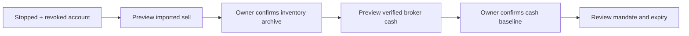

# Trading verification — 2026-10-16

The owner alone enables AutoLive through [the mandate screen](trading.md).
Development and deterministic checks sent no real broker orders. These results
describe software verification, not a deployed account's mode or authority.

## Maintenance boundary — 2026-10-27

The dated results below are historical records for their recorded source versions.
They do not verify the current worktree, deployed account or AutoLive readiness.
Recent maintenance builds, formatting and architecture checks passed. The new
dispatch-migration and backend news fixtures compile but remain unexecuted:
Windows Application Control blocks the Portfolio, Portfolio API, MarketData and
Team behavioral suites. The opt-in SQL migration fixtures have not been run.
Full-project review and end-to-end Auto-trade verification remain incomplete.
These maintenance changes have not executed SQL, deployed services, activated
AutoLive or submitted broker orders.

## Report and research maintenance candidate — 2026-10-23

The owner authorized delivery of these changes on 2026-10-23 with the unavailable
Portfolio behavioral suites and synthetic-preview check skipped. Skipped checks
remain unverified; they do not establish AutoLive readiness. The changes do not
change execution rules, mandate hashes or owner activation.

| Area                             | Candidate behavior                                                                                             | Verification boundary                                                                              |
| -------------------------------- | -------------------------------------------------------------------------------------------------------------- | -------------------------------------------------------------------------------------------------- |
| Daily positions and exit studies | Reconstruct credited base units at recorded broker precision; preserve raw fills and unknown legacy precision. | Full sell, partial sell, historical cutoff and baseline fixtures.                                  |
| Interrupted daily reports        | Claims older than two minutes become Unknown; changed evidence can create a correction.                        | No repeat of an uncertain send or unchanged edit; corrections use only a known message ID.         |
| Manual order status              | Rotate at most five reads through all active account orders each cycle.                                        | Beyond-five and beyond-list-cap fixtures, failures, membership changes and cancellation.           |
| Historical replay                | `ohlc-scenario-v2` uses current verified tick and base/quote scales as explicit historical assumptions.        | Missing precision stays Unknown; retained v1 remains readable; neither version establishes profit. |
| Migration                        | Lock and check disabled authority before cutover; check resumed source and restored destination.               | Deterministic SQL-generation checks; real migration is not part of these tests.                    |

The daily study replaces a same-day v1 result with v2 once, without changing live
policy. Current exchange rules are not proof of historical rules. Precision and
observation time remain in study warnings; fees round up to THB 0.01. Development
uses fake brokers and notifiers. The new Portfolio behavioral checks are skipped
for this handoff because the host's Application Control policy blocks loading test
assemblies. The additional synthetic-preview check is also skipped after its
server start was rejected by tool policy. Existing Team, MarketData, transport and
device checks remain distinct evidence. A successful compilation alone does not
prove the skipped behaviors. Deployment requires disabled AutoLive, a revoked
mandate and verified canonical backups; its operational record stays in ignored
local storage.

## Crypto maintenance candidate - 2026-10-21

This section retains the source-only result from that review; older records below
do not establish today's deployed behavior or AutoLive readiness.

- The explicitly authorized pending-exit mock suite was recorded passing for the
  2026-10-21 candidate,
  including lost CAS, persisted-claim acknowledgement failures, accepted-send
  receipt failures before/after persistence, restart, unknown outcomes and
  no duplicate submissions. No real broker adapter was used.
- Added failing fixtures exposed a quote becoming stale during preparation or
  durable claim when no realtime source is present. Execution now checks the
  same market-freshness rules immediately before and after the durable claim.
  The new fixtures pass with zero sends; an ambiguous durable claim is inspected
  after restart, never replayed.
- Added a failing zero-wallet fixture exposed a whole positive historical lot
  rounding to zero at coarse market precision. Coverage now requires a positive
  executable quantity unless the actual wallet already covers the exact lot.
  Activation remains stopped and quantity, cost and fills remain unchanged.
  Existing valid precision-limited exits still pass.
- Accounting fixtures cover both a full retained historical lot and a synthetic
  tiny residual against a zero wallet. Holdings remain zero, cost/account P&L
  remain unknown, and the symbol remains explicitly unreconciled. This is a
  quarantine, not a fabricated settlement, external-sale allocation or write-off.

Recorded passing on the 2026-10-21 candidate: the complete `Portfolio.Checks` executable with its
optional SQL connection absent, `Portfolio.Api.Checks` (no SQL/network), wallet
source-separation and Crypto-accounting presentation checks, scoped formatting,
and `git diff --check`. Independent review accepted the freshness and coverage
guards. Portfolio goal/Hangfire SQL checks were skipped; isolated SQL persistence
tests were not invoked. Fake CAS/persistence failures are not SQL fault injection.

No backend image was built or deployed. No broker order, ledger repair, mandate,
credential or security change was performed. The separate Team test DLL still
has an enforced Windows trust blocker; it was not rerun or executed through an
alternate route. That block did not prevent the independent Portfolio tests.

Before a separately approved Portfolio-only rollout: freeze and review exact
build inputs, exclude unrelated Company/capital work in progress, verify canonical
backups and the previous Portfolio image for rollback, verify persisted stopped/
revoked authority and outstanding/unknown order evidence, and replace only the
canonical `portfolio` service. Do not include Team/model, MarketData, SQL, Webull,
sidebar or naming changes. Afterward verify read contracts, authority, retained
accounting and unchanged peer identities. Successful deployment would still not
resolve missing historical settlement evidence or authorize live activation.

## Changed areas

- [Strategy and Paper fills](../services/portfolio/Portfolio.Domain/Trading/)
- [Engine, owner controls and report delivery](../services/portfolio/Portfolio.Application/Trading/)
- [Account-isolated SQL and Bitkub adapters](../services/portfolio/Portfolio.Infrastructure/Trading/)
- [Thin trading API](../services/portfolio/Portfolio.Api/Controllers/TradingController.cs)
- [Public execution evidence](../services/market-data/MarketData.Infrastructure/BitkubExecutionMarketReader.cs)
- [Daily Brief controls](../apps/web/features/trading/)
- Team research/manual-mode boundaries, private Docker control-token preparation
  and CI checks.

## Historical local results

| Gate                                                                    | Result                                        |
| ----------------------------------------------------------------------- | --------------------------------------------- |
| `npm run check`, `npm run build`                                        | Passed                                        |
| `npm run format:check`                                                  | Passed                                        |
| `dotnet build Quantara.sln`                                             | Passed, zero build warnings/errors            |
| Portfolio, Portfolio API and MarketData checks                          | Passed                                        |
| `npm run test:architecture`, `npm run test:orders`, `npm run test:team` | Passed                                        |
| Services, lazy DI, AI-worker and Docker checks                          | Passed                                        |
| Trading and Daily Brief browser fixtures                                | Passed; every trading fixture API intercepted |
| Desktop, tablet and phone inspection                                    | Passed; no horizontal overflow                |

| Test evidence            | Coverage                                                                                                                                                                                                                   |
| ------------------------ | -------------------------------------------------------------------------------------------------------------------------------------------------------------------------------------------------------------------------- |
| Fake exchanges           | Entry, partial/full fills, TP/SL, fee credits, retained cost basis, the last unfilled base unit, reconciliation, restart, uncertain submission/cancellation, expiry during a durable claim, owner stop and capital guards. |
| Fake clocks and Telegram | Bangkok midnight, one-message delivery claims and corrections for late fills.                                                                                                                                              |
| Limits                   | Live end-of-day delivery and a continuous 24-hour soak were not used as evidence of these deterministic checks.                                                                                                            |

- Operational checks, database-backup results and account evidence stay in ignored
  local storage such as `.runtime/docker`; they are outside this public verification record.

- Paper models observed top liquidity, not exchange queue priority.
- Entry signals are deduplicated by rules, symbol and completed candle; protective exits have their own typed durable claim so a newly filled position can exit promptly.
- Disabling authority does not prove existing broker orders were cancelled.

## Historical Daily Brief redesign verification

| Area             | Behavior                                                                                                            |
| ---------------- | ------------------------------------------------------------------------------------------------------------------- |
| Initial view     | Trading status is now the initial tab; Team chat and research controls are separate.                                |
| Settings         | Open in a side panel with advanced execution fields collapsed.                                                      |
| Retained details | Completed manual proposals, daily reports, research briefs and learning notes remain available through disclosures. |
| Live review      | Keeps the exact account, rules, limits and required expiry; date shortcuts never submit an activation.              |

The UI update passed lint/typecheck, production build, format checks, solution
build (zero warnings/errors), architecture, Team, Portfolio, services and lazy DI
checks. Trading, manual-order and Team browser fixtures passed with intercepted
APIs, including expiry validation, duplicate-click protection, tab/date changes,
error recovery and desktop/tablet/phone inspection. Implementation checks did not
send real orders or enable live trading.

The verification record does not authorize or claim AutoLive activation. Rollback
artifacts and runtime comparisons belong in ignored local storage. Activation
remains an explicit owner action after the applicable evidence gates and
canonical-backup review.

## Pending exit maintenance checks — source proposal, 2026-10-20

`dotnet run --project tests/Portfolio.Checks -- --pending-exits-only` uses only
in-memory stores, fake clocks and fake exchanges. It checks expiry during broker
preflight/preparation and durable claim persistence, unavailable reconciliation,
unknown-outcome restart deduplication, reserved-versus-owned balance guards and
external full/partial ownership reductions. The old implementation failed the
preflight-expiry regression before the patch.

Stopped/revoked fixtures also cover a fresh wallet with zero or partially reduced
base holdings while the engine retains its original position. A fake restart
keeps execution stopped, discards only the unsent local intent, and never submits
or cancels a broker order. The owned quantity, cost and fills remain unchanged:
wallet snapshots alone cannot establish the external fill price, fees, transfer
history or realized result needed for accounting reconciliation.

A fake activation attempt also rejects zero/partial wallet coverage without
changing the stopped mode, revoked mandate or accounting. Disarm/restart cases
retain ambiguous pending records with broker identity or cancellation claims as
unknown for read-only inspection. Only an unsubmitted pending record without
broker identity or cancellation evidence is cancelled locally. The former
implementation failed this regression by marking an ambiguous record cancelled
without consulting the broker. These checks never submit or cancel broker orders.

The reduction fixtures include a synthetic 1,902-base-unit shortage at eight
decimal places. This remains a genuine ownership mismatch, even when its quote
value is small; it must not use the strictly sub-unit legacy residue rule. A
zero wallet and an external sell do not authorize inventing a matching strategy
intent, changing historical buy quantities, or writing the remaining cost off.
Both history and order-info buy adapters derive quantity from quote amount/rate,
so matching transaction rows alone do not independently prove credited base
quantity. Reconciliation needs explicit broker base-credit/adjustment evidence
and external-fill ownership provenance before any live accounting change.

Before a durable claim, expired unsubmitted intents may be cancelled locally.
Expiry after the claim prevents sending and retains the claim for read-only
reconciliation. An ambiguous record with broker identity is never treated as an
unsent order. A fresh total balance below the owned quantity at verified exchange
precision invalidates only the local pending exit; holdings, cost and fills remain
unchanged until evidence-backed reconciliation. Low available balance alone does
not establish an external sale.

Failure logs record only fixed operation stages, exception type, event kind,
revision and optional HTTP status. Exception messages, stack traces, raw exception
objects, payloads, URLs, credentials and account/order identifiers are omitted.
These diagnostics do not identify a previously swallowed production exception.

This is source verification, not a backend deployment or authorization to replay
retained intents. Before any separately approved backend release, the owner must
disable AutoLive and verify that the mandate is disarmed, inspect current broker
orders/manual fills and unresolved claims, and retain verified canonical backups
and the prior image. Uncertain orders require read-only reconciliation, never
resubmission. Apply only the reviewed backend patch after reconciling external
position changes; starting the API must not reactivate execution. Any subsequent
live activation is a separate owner action. A frontend-only release must not
include or activate this execution patch.

## Guided balance-review recovery — 2026-10-23

The web flow keeps the account stopped and the mandate revoked while an owner
resolves accounting evidence in two explicit steps:

| Step       | Required evidence and outcome                                                                                                     |
| ---------- | --------------------------------------------------------------------------------------------------------------------------------- |
| Inventory  | The imported sell is matched to the selected lot. Unresolved historical quantity and unknown cost/profit remain recorded.         |
| Cash       | A fresh broker cash/available balance is reviewed separately; it does not claim sale settlement or new funding.                   |
| Enablement | Only the owner mandate review can proceed after reconciliation. The flow does not auto-apply, activate AutoLive or submit orders. |

Passed checks include reconciliation web/unit and transport-schema checks,
architecture checks, `npm run check`, the production Web build, Web formatting,
and mocked desktop/tablet/mobile recovery and trading flows. Every API request
in those browser tests was intercepted.

A separate read-only check of the deployed UI reached the actual broker-backed
manual-sale preview. No real accounting change, AutoLive activation or broker
order was performed. The earlier waived Portfolio behavioral suites and
synthetic preview-server check remain unverified.

### Emergency-stop recovery and fewer setup clicks

- An active emergency stop now has a **Clear emergency stop** action. It uses
  the existing Disable command, leaving mode Stopped and the mandate revoked.
  It never opens or approves a mandate automatically.
- Opening Balance review prepares a read-only preview for one unambiguous
  lot/sale, or for cash when no lots remain. Multiple matches require selection.
  Inventory and cash still have separate explicit owner confirmations.
- Initial preview follows committed UI state. Deferred-state checks cover a
  single match, multiple lots/sales, cash-only review, account changes during
  history loading, uncertain confirmation recovery and no retry loops.

### Accounting confirmation concurrency

Inventory and cash confirmations now use the existing shared trading semaphore,
also held by engine/control/evaluation writes. Broker revalidation and the final
atomic save remain within that critical section. This removes the local race
where a background status update invalidated the revision between verification
and persistence. Cross-process conflicts still fail the existing compare-and-swap;
there is no automatic retry or change to proofs, expiry, unknown outcomes or
owner confirmation.

New fake-broker checks assert that a competing engine writer cannot enter during
either confirmation. These compile with the solution but remain **unexecuted**
with the previously unavailable Portfolio behavioral suites; compilation alone
does not establish their runtime result. No real accounting confirmation was
performed during maintenance.

### Historical deployed recovery verification

The release and account state below are retained from the recovery handoff.
They have not been rechecked during the 2026-10-27 maintenance review.

| Check                        | Result                                                                                                                                                                     |
| ---------------------------- | -------------------------------------------------------------------------------------------------------------------------------------------------------------------------- |
| Recovery browser flow        | Desktop, tablet and phone passed: explicit inventory/cash confirmations, clear emergency stop, then mandate review. All API requests were intercepted; no real activation. |
| Trading controls             | Mocked settings, exact mandate/expiry validation, failure recovery and responsive checks passed.                                                                           |
| Chat sidebar                 | Four routes passed at desktop, small desktop, tablet and phone widths. Collapsed content is inert and cannot intercept controls.                                           |
| Release                      | Web and Portfolio image identities verified; five services healthy; three canonical database backups restored and checked in isolation.                                    |
| Account at that verification | Stopped, emergency stop still active, mandate revoked. No accounting confirmation or broker order performed.                                                               |

The recovery browser fixture waits for trading controls to load before collapsing
chat. Checking the server-rendered toggle earlier could miss the desktop chat
opening during hydration and falsely report that a closed panel blocked controls.
The final checks exercised ordinary pointer clicks without force or hidden-panel
CSS overrides. Backend concurrency checks remain compiled but unexecuted as above.

### Recovery from Manual review mode

Balance review previously showed only disabled fields when the account was in
Manual review mode. It now offers **Pause trading to review**, an explicit owner
action through the existing Disable endpoint. The action checks the displayed
account and rules against fresh state, preserves orders and history, then loads
fresh status before preparing a read-only preview. Opening the drawer never
changes trading mode. Unknown orders and saved uncertain confirmations retain
their existing guards.

Regression checks cover deferred state commits, one stop on a double click,
failed stops, account changes, unresolved orders, missing mandates and retained
uncertain proofs. The browser fixture includes both emergency-stopped and Manual
review entry states at desktop, tablet and phone sizes; all API calls are mocked.
Both entry states passed at all three widths after deployment. The older Web
image reproduced the missing-action failure. Frontend checks, formatting,
production build and architecture checks also passed. The Web-only release kept
AutoLive disabled, retained the prior image and verified three database backups
through isolated restores; it did not alter backend code or trading authority.
